# Intro to R

### Logging into RStudio web

You will be provided an account name and the password at the beginning of class.

To access the **Terminal** built into **RStudio** Server.

-   Click on this link: 

    -   [https://gsafcbig01.ccbb.utexas.edu](https://gsafcbig01.ccbb.utexas.edu/)

-   Enter your **studentNN** account name (assigned in class) and our password, then click the **Sign In** button

-   In the **RStudio** web application, select the **Terminal** tab above the text entry window on the left.

You should now see a command line in the **RStudio** window.

## Introduction to R

R and RStudio (RStudio is an 'IDE', integrated development environment), together constitute one of the most popular tools used by researchers to analyze big data. Because it was first designed by statisticians for statistical purposes, R is a really nice language for data science.  Wrangling massive amounts of information and producing publication-ready graphics and visualizations are more straightforward with R than other languages, and its use in data science remains strong. 

R was created in the early 1990s by University of Auckland statisticians Ross Ihaka and Robert Gentleman. Ihaka and Gentleman, "identified what they called a common need for a better software environment" which lead them to first develop R based on a language called "S". They started working on R in the early 90s, but version 1.0.0 wasn't released until February 2000.  So it's about 25 years old, officially.

{width="440"}

 R is an  open-source language, which means that anyone can contribute, and the course of its development is based on the collaborative effort of many many people.

The scope of R is vast, with many packages and data structures. However, you will come to use specific packages, and the ones you use most often will become very familiar to you over time, like old friends. This course will develop your skills in base R, which will allow you to strike out into the world and make new friends.

R is an interpreted language, which means that users access its functions through a command-line interpreter. We will be using the RStudio IDE, but lets first see what it's like to use R at the command line.

 Type R. into your terminal, and run a couple of "calculator" commands.

```{r}
3+2*4
5^5
```

 Define an object with the name 'animal', return the object value.

```{r}
animal <- "elephant"
animal
```

But we will not be using R from the terminal, we will be using the RStudio IDE. What you see here, however, is actually an Rmd file that is layered over the standard R editor (in order to allow more formatting). So lets take a short detour over to a more standard setup that you will be using outside of this course.

 

## **More information/Resources**

[RStudio user guide](https://docs.posit.co/ide/user/)

# RStudio orientation

## RStudio panes

The large window (aka pane) on the left is the **Console** window. If you open or create a file, it is placed in the **Source** window, generally to the top left. The window on the top right is the **Environments** window (**Environment / History / Connections**) and the bottom right window is the  **Output** window (**Files / Plots / Packages / Help / Viewer**). We will discuss each of these panes in turn below.

You can customise the location of each pane by clicking on the 'Tools' menu then selecting Global Options --\> Pane Layout. You can resize the panes by clicking and dragging the middle of the window borders in the direction you want.

 

To set up RStudio to run the current line by pressing \<`CTRL`\>\<`ENTER`\>, go to tools -\> global options\
-\> code. Set the `Ctrl+Enter executes` option to `current line`. I recommend doing this !

 

**Console**

The Console is where R evaluates all the code you write. You can type R code directly into the Console at the command line prompt, `>`. You can also highlight sections of code and press \<`Ctrl`\>\<`Enter`\>. To highlight a line, click its number to the left, and to then highlight multiple lines, drag your mouse down or up.

### **Environment/History/Connections**

The Environment / History / Connections window shows you lots of useful information. You can access each component by clicking on the appropriate tab in the pane.

-   The 'Environment' tab displays all the objects you have created in the current (global) environment. Drop-down/list

-   The 'History' tab contains a list of all the commands you have entered into the R Console.

-   The 'Connections' tab allows you to connect to various data sources such as external databases.

### **Files/Plots/Packages/Help/Viewer**

-   The '`Files`' tab lists all external files and directories in the current working directory on your computer. It works like file explorer (Windows) or Finder (Mac). You can open, copy, rename, move and delete files listed in the window.

-   The '`Plots`' tab is where all the plots you create in R are displayed (unless you tell R otherwise). Zoom/scroll/export

-   The '`Packages`' tab lists all of the packages that you have installed on your computer. You can also install new packages and update existing packages by clicking on the 'Install' and 'Update' buttons respectively.

-   The '`Help`' tab displays the R help documentation for any function.

# System and packages

## **Packages**

You can think of a package as a collection of functions. There are three main sources of packages: CRAN (Comprehensive R Archive Network), Bioconductor, Github.

The base installation of R comes with many useful packages as standard. These packages will contain many of the functions you will use on a daily basis. However, as you start using R for more diverse projects (and as your own use of R evolves) you will find that there comes a time when you will need to extend R's capabilities

There are different ways to load packages. Most of the packages we need are already present in your RStudio environment. For example, you can load the stringr package, because it is already installed (library(stringr)). Try to load the mmcards library (it is not yet installed):

```{r}
library(mmcards)
?shuffle_deck
```

 

## **CRAN packages**

To install a package from CRAN you can use the `install.packages()` function. The mmcards package is not currently installed. If you want to install the `mmcards` package (which allows installations from GitHub), enter the following code into the Console window of RStudio (note: you will need a working internet connection to do this). Now check your local library on the command line.

```{r}

install.packages('mmcards', dependencies = TRUE)
library(mmcards)
game_deck <- shuffle_deck()
```

 

You may be asked to select a CRAN mirror, just select '0-cloud' or a mirror near to your location. The `dependencies = TRUE` argument ensures that additional packages that are required will also be installed.

It's good practice to occasionally update your previously installed packages to get access to new functionality and bug fixes. To update CRAN packages you can use the `update.packages()` function.

```{r}

update.packages(ask = FALSE)
```

 

The `ask = FALSE` argument avoids having to confirm every package download.

## **Bioconductor packages**

To install packages from Bioconductor the process is a [little different](https://cran.r-project.org/web/packages/BiocManager/vignettes/BiocManager.html). You first need to install the `BiocManager` package. You only need to do this once unless you subsequently reinstall or upgrade R. We don't need to run any of this code, because all of these packages are already installed.

```{r}

install.packages('BiocManager', dependencies = TRUE)
```

 

Once the BiocManager package has been installed you can either install all of the 'core' Bioconductor packages with

```{r}

BiocManager::install()
```

 

or install specific packages such as the 'GenomicRanges' and 'edgeR' packages.

```{r}

BiocManager::install(c("GenomicRanges", "edgeR"))
```

To update Bioconductor packages just use the `BiocManager::install()` function again.

```{r}

BiocManager::install(ask = FALSE)
```

Again, you can use the `ask = FALSE` argument to avoid having to confirm every package download.

## **GitHub packages**

There are multiple options for installing packages hosted on GitHub. Perhaps the most efficient method is to use the `install_github()` function from the `remotes` package (you may need to install the 'remotes' package first ( install.packages('remotes') ). Before you install, you will need to know the GitHub username of the repository owner and also the name of the repository. For example, the development version of `dplyr` from Hadley Wickham is hosted on the tidyverse GitHub account and has the repository name 'dplyr' (just Google 'github dplyr'). To install this version from GitHub, use

```{r}
remotes::install_github("tidyverse/dplyr")
```

The safest way to update a package installed from GitHub is to just reinstall it using the above command.

## **Using packages**

Once you have installed a package onto your computer, it is not immediately available for you to use. To use a package you first need to load the package by using the `library()` function. For example, to load the mmcards package you previously installed.

```{r}
library(mmcards)
```

Sometimes it can be useful to use a function without first using the `library()` function. If, for example, you will only be using one or two functions in your script and don't want to load all of the other functions in a package then you can access the function directly by specifying the package name followed by two colons and then the function name. This is why we used the following command above to install from github

```{r}
detach("package:mmcards", unload = TRUE) #this detaches the library
shuff_deck <- shuffle_deck() # you will see an error message
shuff_deck <- mmcards::shuffle_deck()
```

 

This may seem a bit confusing at first, but managing packages will become second nature after using R for a short while. In addition, if you are following a manual or a vignette (a short tutorial) for a specific tool, the packages will all be listed at the top, and there is no extra knowledge needed about packages in order to get going with analysis (in most cases). Just ask the internet how to install a package and the answer is almost always correct.

## **File Orientation**

### **Working directories**

The working directory is the default location where R will look for files you want to load and where it will put any files you save. You can check the file path of your working directory by looking at bar at the top of the Console pane.

If we were using a project, the home directory would be associated with the project name. For this class, we will not be working with projects, since we are just getting oriented to the RStudio IDE. 

```{r}
getwd()
```

 

Examples of ways that R can interact with the underlying file system.

 

```{r}
#to list files in current directory
list.files()
#to create a directory in the file system
dir.create('test_dir')
list.files()
```

 

### Naming R files

Although there's not really a recognized standard approach to naming files, there are a couple of things to bear in mind.

First, avoid using spaces in file names by replacing them with underscores or hyphens. One reason is that some command line software (especially many bioinformatic tools) won't recognize a file name with a space which creates numerous problems. For the same reason, also avoid using special characters (i.e. \@£\$%\^&\*(:/) in your file names.

Avoid using the word *final* in any file name - it rarely is!

Whatever file naming convention you decide to use, try to adopt early, stick with it and be consistent.

# Coding basics

## **Coding in R**

### Some guidelines:

-   R is case sensitive.

-   Anything that follows a `#` symbol is interpreted as a comment and ignored by R. Annotate heavily!! Your future self will be happier.

-   In R, commands are generally separated by a new line. You can also use a semicolon `;` to separate your commands on the same line but this is rarely done.

-   If a continuation prompt `+` appears in the console after you execute your code this means that you haven't completed your code correctly. This often happens if you forget to close a bracket. Either try to finish the command on the new line, or hit escape on your keyboard until the console resets.

-   In general, R allows extra spaces inserted into your code, in fact using spaces is actively encouraged. However, spaces should not be inserted into operators i.e. `<-` should not read `< -` (note the space)

-   If your console 'hangs' and becomes unresponsive, try pressing the escape key (esc) or clicking on the stop icon in the top right of your console. This will terminate the current operation in most cases.

### R as a calculator -The R REPL (read evaluate print loop)

-   In the code below, operators and functions are used

```{r}
2+2
log(1)             # log base e
log2(1)            # log base 2
exp(1)             # e^x
sqrt(4)            # square root
4^2                # 4 to the power of 2
pi                 # not a function but useful
17%%6              # modulo operator
                    # Order of operations, options(digits = 10)
```

### **Objects, Variables, Datatypes**

Objects are the central concept that unites R. Everything in R can be thought of as an object.

Examples of objects include: a single number, a character string (like a word), a vector, a data table, or a highly complex plot or function. Understanding how you create objects and assign values to objects is key to understanding R.

To create an object we simply give the object a name. We assign a value to this name using the *assignment operator* `<-`. The assignment operator is a composite symbol comprised of a\
'less-than' symbol `<` and a hyphen `-` .

```{r}
my_obj <- 5
```

In the code above, we created an object called `my_obj` and assigned it a value of the number `5` using the assignment operator. You can also use `=` instead of `<-` to assign values. Some people do this, but it is considered bad practice.

To view the value of the object, enter the name of the object in the console, or execute it from the IDE \<`CTRL`\>\<`ENTER`\>.

```{r}
my_obj
```

``` text
## [1] 5
```

 

Check 'Environment' tab for the object.

If you click on the down arrow on the 'List' icon in the same pane and change to 'Grid' view RStudio will show you a summary of the objects including the type (numeric - it's a number), the length (only one value in this object), its 'physical' size and its value (5 in this case).

 

### **Naming objects**

Naming your objects in R is important. Good object names should be short and informative. If you need to create objects with multiple words in their name then use either an underscore or a dot between words, or capitalise the first letter of new words. I prefer using underscores ([*snake case*](https://en.wikipedia.org/wiki/Snake_case)).

The examples below show how to assign a variable name to a character string.

```{r}
input_argument_last <- "cell type 1"
```

```{r}
input.argument.last <- "cell type 1"
```

```{r}
inputArgumentLast <- "cell type 1"
```

 

Code break: Create some additional objects

Write some code in the Source window, and execute it \<`CTRL`\>\<`ENTER`\>. Use the mathematical operators above, and create objects by assigning variable names.

```{r}

num_1 <- 33
char_1 <- "don\'t think so!"
num_2 <- num_1 / 2
num_4 <- 1 + num_2
#num_5 <- num_1 + char_1
num_4
num_4 = char_1 + 1
num_4
```

When learning R, understanding errors and warnings can be frustrating (what's an argument or a 'binary operator' ?). To find out more information about a particular error, Google a version of the error message, e.g. 'non-numeric argument to binary operator error + r' .

### **'Base R' Functions**

There are many functions, operators, and objects already available in R distributions. These are referred to as 'base R' functions, 'base R' operators, etc. Functions are R objects that take an argument, carry out some operations, and typically return a value.

For example, the log() call made above used the log() function. It also takes other arguments, such as the base of the logarithm that you may want to use.

 To get help for a function, type a question mark before the name of the function and execute it.

```{r}

?log
```

 

### Character objects

Numbers are pretty easy to understand in R, and they generally behave as expected. Characters and manipulation of character strings, however, may not be so intuitive to beginners in programming, so lots look at the variety of manipulations possible for the object type character.

**Quoting**

```{r}
# A string must start and end with the same type of quote.
message <- "Hello"
message <- 'Hello'

# Double quotes can contain single quotes.
message <- "The AI's brain glitched"

# Single quotes can contain double quotes.
message <- 'The AI said, "Kneel before me!"'

```

**Pasting**

```{R}
samples <- c("wild_type", "mutant", "control")

paste0(samples, ".csv")
paste(samples, "csv", sep='.')

# [1] "control.csv" "treated.csv" "blank.csv"
```

Creating character vectors

```{r}
file_names <- c("sample 1.csv", "sample 2.csv", "sample 3.csv", "sample 4.csv")
file_names_2 <- paste0(rep('sample_', 10), 1:10)
file_names_2

nchar(file_names)

```

Clean up names

```{R}

label <- "  wild type  "
label <- trimws(label)
label <- gsub(" ", "_", label, fixed=TRUE)
label

#Alternate
label <- "  wild type  "
gsub(" ", "_", trimws(label), fixed=TRUE)

```

### **First look at the vector in R.**

We used a vector to hold a few character strings above. The c() function is short for concatenate and we use it to join together a series of objects and store them in a data structure called a **vector.**

```{r}
my_vec <- c(2, 3, 1, 6, 4, 3, 3, 7)
```

 

A vector is like a one-dimensional container that holds a series of elements, all of the same type -- for example, a vector of numbers, or a vector of character elements. Although vectors are a data structure, they are considered to be a fundamental object type because vectors constitute other common data structures (like dataframes).

#### Code Break: Introduction to vectors

Once we've created a vector, we can use other functions to get information about this object. For example, we can calculate the mean, variance, standard deviation and number of elements in our vector by using the\* `mean()`*,* `var()`*,* `sd()` *and* `length()` \*functions. Call these functions on the vector to see what happens.

```{r}
my_vec <- c(2, 2, 3, 9, 4, 5)
typeof(my_vec)

#your code here:


```

#### Exploring vectors with seq(), rep(), and sample()

Some code for creating and manipulating vectors is given below. Play with the code, or make your own and try to understand what is happening. If you want to read about the functions, type a question mark followed by the function name.

```{r}
#The seq() function
seq(1,20)
seq(1,20,.1)
length(seq(1,20))
c( seq(1,10), seq(20,30) )
#The rep() function
c( rep(1, 10), rep(2,10) )
rep("abc", 10)

#query the sample function (?sample), and try to use it 
#query the rnorm function, and try to use it

#your code here:


```

In R, to "unset" or remove a variable from your environment, you can use the `rm()` function.

#### Functions typically act on both indiviual objects AND vectors.

An example of file names is given below. Use the same commands as above (trimws, gsub) to change each element of the vector.

```{R}
samples <- c("  wild type", "mutant  ", "  control  ")

#your code below for trimws and gsub


```

 

The next section focuses on extracting or altering elements of vectors.

**Vectors and extracting elements**

-   The way to 'index' a vector is by using brackets `[ ]` .
-   This syntax is common to vectors and also to lists

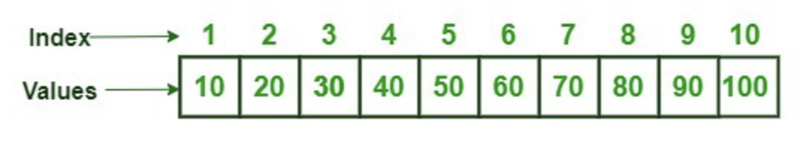

By positional indices

```{r}

my_vec <- c(2, 2, 3, 9, 4, 5)
my_vec[3]                       #extract single element
my_vec[3:8]                     #extract a range of elements
my_vec <- my_vec[c(3,4,5,6,1,2)] #re-order elements of a vector note 'NA'
#Not this:
my_vec <- my_vec[3,4,5,6,1,2]    #the extraction operator [] expects a vector
```

# Coding proper

## Re-Entry into R

At this point, we have come into contact with a few object types and a data structure in R (i.e., numeric, character, boolean, vector).

We've also learned how to interact with a vector using functions and by **indexing** elements.

 Until now, however, we've been using with these objects without fully appreciating their place in the range of objects in the R language.  This was intentional, because gaining some familiarity with objects and how they interact from a more intuitive standpoint is a good background to have for what comes next.

## The bigger picture

+-------------------------------+-------------------------------+
| Objects to be covered         | Data Structures to be covered |
+-------------------------------+-------------------------------+
| -   Numeric (integer, double) | -   vector                    |
|                               |                               |
| -   character                 | -   list                      |
|                               |                               |
| -   logical                   | -   dataframe                 |
|                               |                               |
| -   factor                    | -   matrix\*                  |
|                               |                               |
| -   complex                   | -   array\*                   |
+-------------------------------+-------------------------------+

We will re-enter coding in this section, beginning again with the vector, but in greater depth. Here we will encounter most of the basic object types as individual elements of these vectors. We will then discuss lists, and move on to dataframes as quickly as possible, since it is the dataframe where the power of R is best leveraged.

There are four primary types of atomic vectors: logical, integer, double, and character*.*

Have a go at creating some of them. Then use the function typeof() to check their type.

*Code*:

```{r}
num_1 <- c(10:12)
num_2 <- c(1:10)/3
char_1 <- c('coding', 'region')
logical_1 <- c(T,F,F)

```

 

### Coercion

Even though R vectors have a specific type, it's quite easy to convert them to another type. This is called **coercion**. This flexibility works mostly to our advantage; for example, we generally don't worry about whether a vectors is an integer versus double in R, and just consider them to be numeric. But unexpected coercion can cause confusing errors to arise, so always consider this possibility when coding.

For explicit coercion, use the as.\*() functions.

```{r}
v_log <- c(TRUE,FALSE,FALSE,TRUE)
as.integer(v_log)
as.numeric(v_log)
as.character(v_log)
as.logical(as.integer(v_log))
```

 

Warning: implicit coercion

Coercion can also be triggered by other actions, such as assigning an element of a different type into an existing vector.

 

```{r}
num_vect <- c(1:10)
num_vect <- c(num_vect, 'string')
num_vect
num_4 <- as.integer(c(1:10, 1.3))
```

 

Our numeric vector was silently coerced to character in one case, and in the other, the number was rounded. Notice that R did this quietly, without warning. Always pay attention to the questions: Is this object of the type I think it is? How sure am I about that?

 

### **Logical operators, and booleans**

-   Logical operators which compare values and create boolean outputs produce the underlying logic that will allow you to interact with objects like vectors and dataframes (tables).

-   The boolean outputs produced by logical operators allow you to slice, modify and remove elements contained in vectors, lists, and dataframes.

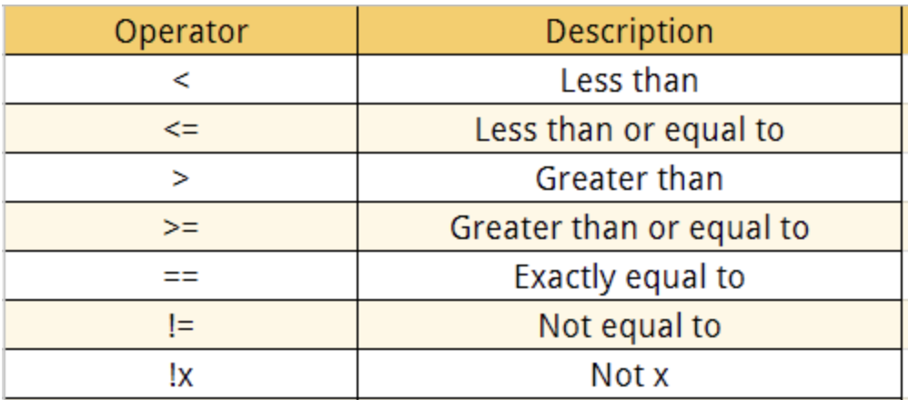

#### Code break:

1.  Test a numerical vector with the above operators using a number (vec \< 1), and look at the output.

2.  Vectorization: Create another vector and see how the operators behave when comparing two vectors. (You must use vectors of the same length.)

Examples (create your own underneath the examples)

```{r}
#examples
v1 <- c(2, 2, 3, 9, 4, 5)
n1 <- 5
v1 < n1
v1 <= n1
v2 <- 1:12 #can use the colon alone to create vectors!
v3 <- rev(5:16)
v2 < v3
v2 == v3

#your code here:


```

**Extraction of elements using booleans**

We used `[ ]` above to slice elements, but boolean vectors also can be used to slice out elements. Only the indices where `TRUE` occurs will be extracted, and indices where `FALSE` occurs will be ignored. Here is an example.

```{r}
vect1 <- c(1:10)
vect2 <- c(rep(TRUE, 3), rep(FALSE, 7))
vect2
vect1[vect2]
```

In the code below, try to predict what the sub_vector will look like, before executing that line.

```{r}
vv = c(1:3, 10:16, -5, 2) #note the shorter way to create number ranges !
vv
sub_vector <- vv[vv < 12]
sub_vector

```

**Challenge**

Use a simple expression to find the element that is equal at the same position in the following two vectors?

```{r}
my_vec1 <- 1:11 
my_vec2 <- rev(5:15)

```

**Booleans with logical operators** `&`, `|`, **and** `!` .

```{r}
vect1 <- c(T,T,T,F,F,F)
vect2 <- c(T,T,F,F,F,T)
vect1 & vect2
vect1 | vect2
vect1 & !vect2

```

Test what will happen if the boolean vector is shorter. Make a boolean vector b1 that has 3 boolean values and use it to index v1. What is going on!

```{r}
v1 <- 1:10 #not this additional way to create a numeric vector !
b1 <- 

#index v1 with b1, and observe the behavior


```

**Vectorization**

We have been using vectorization without having really discussed it in depth. One of the great things about R functions is that most of them are vectorized. This means that the function will operate on all elements of a vector without needing to apply the function on each element separately. This will become even more useful when manipulating data tables.

```{r}
c(1:10) + c(21:30)
c(1:10) / c(21:30)
c(1:10) %% c(21:30)
before <- c(100, 150, 200)
after  <- c(120, 135, 250)
change <- after - before
percent_change <- (after - before) / before * 100

```

### Lists

Lists are needed for holding elements that violate the constraints required of atomic vectors, i.e., if one or both of the following are true. Note: lists are also technically a type of vector.

-   An element of the list has length greater than 1.

-   The individual elements to be collected together are not of the same type.

 

Lists are a more general form of a vector. Whereas a vector must contain elements that are all the same object type, the elements of a list may be various types. Lists are also commonly created when you want to name each element and refer to these elements by their names, rather than index. However, lists need not have explicit names.\

There are three common ways to create a list from scratch:

1.  Provide the element names together with the elements of the list

```{r}
list1 <- list(element1 = 1, element2 = c(2,3,4), element3 = T)
```

2.  Create a list and then provide the names as a vector.

```{r}
list1 <- list(1, c(2,3,4), T)
names(list1) = c("element1", "element2", "element3")
```

3.  Convert some other object to a list

```{r}
a_vect <- c(11:20)
a_list <- as.list(a_vect)
```

Add to a list

```{r}
list1$element4 <- 9
list1[['element5']] <- 10
```

R's expressions for nested lists: carefully note how the console represents these.

```{r}
list1 <- list(1, c(2,3,4), T)
names(list1) = c("element1", "element2", "element3")
list1$element4 <- list(1,2)
names(list1$element4) <- c('sub1', 'sub2')
list1[['element5']] <- list(list(3), list(4,5))
#note on spaces in list names
```

***Take note!***:

What is going on with the following two commands? They produce different objects.

```{r}
#Two different methods of list generation that are not the same
vect1 <- list(c(5:10))  
vect2 <- as.list(c(5:10)) 
```

**Indexing a list**:\
With vectors, we used brackets [] for indexing by position.\
With lists, the elements can be indexed in three ways, all of which are very important to understand.

1.  Single brackets (returns a list of the selected element or elements)

```{r}
list1 <- list(name1 = 1, name2 = c(2,3,4), name3 = T, name4 = NA)
list1[2] #returns same type as 'parent' type
#or
list1['name2']
```

2.  Double brackets (returns the element indexed)

```{r}
list1 <- list(element1 = 1, element2 = c(2,3,4), element3 = T)
list1[[2]] #returns the element itself
#or
list1[['name2']]

```

3.  Dollar sign syntax (`$<element name>) (returns the element indexed)`

```{r}
list1$element2 #returns the element itself
```

Question: how do we know the output is a list in the above 3 cases.

By the way, a vector can also have element names! However, note the format when R prints out the object. Also, the vector's elements cannot be 'directly' indexed by their names.

```{r}
a_named_vect <- c(5:10)
names(a_named_vect) <- letters[1:6]
a_named_vect
```

 

## Some additional tools

**stringr**: The stringr package contains many functions for string operations. These functions are much easier to use than R's default functions, and I highly recommend them.

```{r}

library(stringr)
library(glue)
str1 <- c("Hello", "hello.there", "hi", "ahoy", "nope")

#tests for a pattern
str_detect(str1, 'he') | str_detect(str1, 'op')  

#splits at a pattern, and selects which 'split' to keep
str_split_i(str1, 'll', 1) 
str_split_i(str1, 'll', 2) 

#paste together strings (like paste0)
str_c("Hello ", "there") 

#count number of occurrences
str_count(str1, "He|[.]") #!


#glue objects and characters together instead of paste0
name <- "Alice"
age <- 30
statement <- glue("My name is {name} and next year I will be {age + 1}.")
statement

```

 

#### Coding exercises for strings

**exercise 1**

-   a vector of sample names is presented below. Use the stringr functions and glue() to do the following tasks.

    1.  Use `str_split_i()` to extract the gene names and tissues into separate vectors.

    2.  Use `str_detect()` to identify gene names containing `"BRCA"`.

    3.  Use `glue()` to create summaries for each sample as follows:

        BRCA1 was measured in breast tissue

        TP53 was measured in lung tissue

        BRCA2 was measured in breast tissue

        EGFR was measured in lung tissue

        TP53 was measured in liver tissue

```{r}
library(glue)
samples <- c("BRCA1:breast", "TP53:lung",
             "BRCA2:breast", "EGFR:lung", "TP53:liver")
gnames <- str_split_i(samples, ':', 1)
tnames <- str_split_i(samples, ':', 2)
output <- glue('{gnames} was measured in {tnames} tissue')
```

**exercise 2 (more advanced)**

-   Given the short DNA sequences, do the following tasks:

    1.  Use `str_detect()` to collect sequences containing `"ATG"` in a vector.

    2.  Use `str_count()` to count occurrences of `"ATG"` in each sequence.

    3.  Use `str_count()` with the pattern `"G|C"` to count the total number of G and C bases in each sequence.

    4.  Use `glue()` to create summaries as follows for each ATG-containing sample:

        'Sample S1 contains 2 occurrences of ATG and 3 G or C bases.'

```{r}
sample_ids <- c("S1", "S2", "S3", "S4")
sequences <- c("ATGCCATG", "GGCCAATT",
               "ATGATGATG", "TTAACCGG")

```

#### Additional functions

**sample() and table()**: Sample from a vector; quickly tally number of appearances of each element in a vector

```{r}
#| eval: false
number_vect <- sample(1:10, 1000) # problem here
table(number_vect) # commonly used with hist() function
```

 

**rnorm()**: sample from a normal distribution

```{r}
?rnorm
rnorm(5,10,1) #note default arguments
```

 

**order()**: Sort a vector numerically or alphabetically. Note: returns the indexes of the vector used to sort the vector.

```{r}
set.seed(5) #note on seed
number_vect <- sample(1:10)
ordering <- order(number_vect, decreasing = T)
#What to do with this new ordering?

```

**%in%**: This strange-looking operator returns a boolean vector based on whether the elements of the first vector are found in the second.

```{r}
vect_1 <- c(1:20)
vect2 <- c(7:11)
vect1 %in% vect2
!vect1 %in% vect2
#write code below to select only elements in vect1 that appear in vect2


```

### Some loose ends: NA, NaN, Inf, -Inf

NA is the object that R uses to indicate 'not available', or 'missing'. It will incorporate itself into a vector and take the same data type as the elements around it when R needs to use it. Therefore, it is necessary to know for certain if your data contains NAs by testing using the function `is.na()`.

```{r}
a_vect <- c(1,-3,5,NA,7, NA)
typeof(a_vect[4])
is.na(a_vect)
sum(is.na(a_vect))
```

NaN is the object produce when there is no possible mathematical result for an operation, for example, when dividing 0 by 0, or when taking the square root of a negative number.

```{r}
a_vect/0
sqrt(a_vect)
is.nan(sqrt(a_vect))
```

We can see above how Inf, -Inf are produced when dividing by zero. Another common way that -Inf is produced is when taking the logarithm of zero

```{r}
log(rep(0, 5))
```

# Control Structures

### For-loops and conditionals

You've now been introduced to most of the basic R object types. We will be working with these objects now using `for` loops in order to develop some coding skills that are commonly used.

```{r}
input = c(2,4,6,8)
for (i in input) { 
  print( (i)^.5 )
  }

```

## **Conditionals: `if`, `else if`, `else`**

Let's write a more complicated for-loop using if and else.

```{r}
for (i in 1:10) {
  if (i%%2 == 0) { 
    print(paste0(i, ' is even')) 
  } 
  else { 
    print(paste0(i, ' is odd'))  
  }
}

```

Use of 'accumulators' with for loops

```{R}
odds <- c()
evens <- c()
for (i in 1:10) {
  if (i%%2 == 0) { 
    evens <- c(evens, i)
  } 
  else { 
    odds <- c(odds, i)
  }
}
evens 
odds
```

Use of 'incrementers' with for loops (and some debugging tips)

```{R}
dna <- "ACTCGNNCGGCTATT"
dna_v <- str_split(dna, "")
gc_count <- 0
for (base in dna_v){
  if (base == "G" | base == "C") {
  gc_count = gc_count + 1
  }
}
gc_count

```

#If, else, and else if

```{R}
for (i in 1:10) {
  if (i%%2 == 0) { 
    print(paste0(i, ' is even')) 
  } 
  else if (i == 5) {
    print('halfway there!') 
  }
  else { 
    print(paste0(i, ' is odd'))  
  }
}
```

**Optional challenge**: Change the code so that '5 is odd' also prints.

### Code break

Use a for loop along with a condition test and an accumulator (in this case, a vector) to gather all query sequences that contain the query (use str_find).

```{R}
sequences = c("ATGCGT", "ACGT", "TTAAGC", "ATCGCACG")
query = "ACG"
#your code here:


```

Read some more complicated code, and figure out why `next` (skips to the next iteration) and `break` (breaks out of the for loop and ends it) are used. This code is intended to check for a user, and send a message when that user is found.

```{R}
usernames <- c("alice", "", "bob", "carol", "", "dave")
target <- "carol"
flag = F
for (user in usernames) {
  if (user == "") {
    next  
  }
  print(glue("Checking user: {user} \n"))
  if (user == target) {
    message <- glue('found {target}!, Stopping search\n')
    print(message)
    flag = T
    break
  }
}
if (flag == F){
  cat(glue('target {target} not found'))
  }
cat("Done\n")

```

### **Functions**

A **function** is a reusable block of code. It can take **arguments** (inputs) and give back a **return value** (output).

**A function: arguments and output**

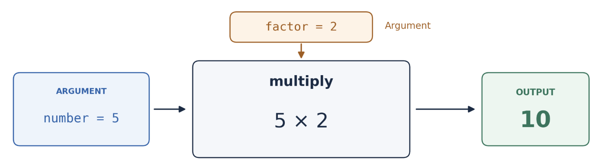

```{r}
multiply <- function (number, factor){
  return(number*factor)
}
multiply(5,2)
```

### **`function`** begins the function definition.

-   **`multiply`** is the function’s name, assigned using `<-`.

-   **`number`** and `factor` are arguments.

-   The instructions enclosed in **`{ }`** form the function’s **body**.

-   **`return()`** sends a value back to the code that called the function.

Why use functions?

-   Avoid repeating yourself

-   Break a big problem into small, named, testable pieces

### Try your own:

Create a function that takes in two vectors as parameters and multiplies them together using the `*` operator.

```{R}
#Your code here:


```

### Biological example

High quality nucleotides in a DNA sequence are indicated by upper-case letters and low quality nucleotides are indicated by lower-case letters. What is the following function doing? Read it, and figure it out based on the output. (Remember, vertical bar `|` in R denotes the logical 'or' operator.)

After you understand it, alter the function to output percentages of high quality and low quality bases in the sequence (rather than counts). Calculate precentages relative to the sequence length.

```{R}
quality_counts <- function(seq){
  highqual <- str_count(seq, "A|C|G|T")
  lowqual <- str_count(seq, "a|c|g|t")
  output <- c(highqual, lowqual)
  return(output)
}
inSeq <- ('ACGTacTGaaACACGTTGAGTacTGaaACGTacTGaa')
quality_counts(inSeq)
```

More complex:

Make a function that calls this function on each sequence from an input list of sequences. Output a list named by the sequences.

**Pseudocode**

Function input: list of sequences

Function output: list of percentage vectors

1.  Initialize accumulator list ( an empty list; my_list \<- list() ).

2.  For each sequence: call quality_counts .

3.  Add output fo quality counts in the list.

4.  Return the list.

    Hint: to simply add an element to an empty list, use append() like so: empty_list \<- append(empty_list, list(\<new element\>).

```{R}
inSeq <- as.list(c(
'ACGTacTGaaACACGTTGAGTacTGaaACGTacTGaa', 'ACGTacTGaaACACGTTGCCCTTGGGGGTGaaACGTacT', 'ACGTacTGTTTGGGGGTGAGTacTGaaACGTacTGGG'
))
#your code here:
test_sequences <- function(seq_list){
  out_list <- list()
  for (i in seq_list) {
    sub_vect <- quality_counts(i)
    out_list <- append(out_list, list(sub_vect))
  }
  return(out_list)
}
test_sequences(inSeq)

```

Named lists make objects more understandable

```{R}
inSeq <- as.list(c(
'ACGTacTGaaACACGTTGAGTacTGaaACGTacTGaa', 'ACGTacTGaaACACGTTGCCCTTGGGGGTGaaACGTacT', 'ACGTacTGTTTGGGGGTGAGTacTGaaACGTacTGGG'
))
names(inSeq) <- c('seq1', 'seq2', 'seq3')

test_sequences <- function(seq_list){
  out_list <- list()
  for (seqName in names(seq_list)) {
    sub_vect <- quality_counts(seq_list[[seqName]])
    out_list[[seqName]] <- sub_vect
  }
  return(out_list)
}
gc_counts <- test_sequences(inSeq)


```

## Dataframes !

R is designed for handling data in the form of large tables, so this section is where we'll see the full power of R for data analysis. The underlying structure of a dataframe is just a list of vectors, so we already understand something about how to interact with dataframes.

**Slicing Dataframes**:

Slicing a dataframes means extracting specific rows and columns. This can be done in a number of ways in base R:

1.  Using list syntax (only for columns)

```{r}

dataf <- read.table("walrus_sounds_date_random.tsv", header = T, sep = "\t")
dataf[['vocalization']]
```

2.  Using numerical row and column indices:

```{r}

dataf <- read.table("walrus_sounds_date_random.tsv", header = T, sep = "\t")
dataf[3,2]
dataf[,2]
dataf[1,]
dataf[1:2,1:2]
```

3.  Using column names and row names

```{r}

dataf <- read.table("walrus_sounds_date_random.tsv", head = T, sep = "\t", fill=T, na.strings = "")
#colnames(dataf) <- c('name', 'vocalization', 'time_min_sec', 'date')
dim(dataf)
row_names_vect <- paste0(rep('row', 200), 1:200)
rownames(dataf) <- row_names_vect
#slice using column and row names
dataf[c('row3','row8'), c('name', 'time_min_sec')]
#slice using indices
dataf[3:8, 1:2] 
dataf[3:8,]
dataf[,-c(1,2)]
dataf[,-4]
#Note the difference between the following (picking out a single column returns a vector, but that behavior can be controlled)
dataf[,4]
dataf[,4, drop = FALSE]
```

**Adding a new column**

Convert the dataframe 'time_min_sec' column to total seconds, and create a new column called 'seconds'.

**Code challenge:**

Convert the dataframe 'time_min_sec' column to total seconds, and create a new column called 'seconds'. hint: first split the time column on the pattern ':', multiply the first split by 60 and add to second)

```{R}
#your code here
dataf$seconds <- as.numeric(str_split_i(dataf$time, ':', 1))*60 + as.numeric(str_split_i(dataf$time, ':', 2))
```

 

`ifelse` in R

The ifelse operator in R is widely used, and it's important to know it. It combines if and else with outputs. Here's an example.

We want to characterize vocalization length as short or long

```{R}
#your code here
mean_val <- mean(dataf$seconds)
dataf$voc_length <- ifelse(dataf$seconds < mean_val, 'short', 'long')

```

**Slicing dataframes using logical vectors**

Above, we have been selecting rows and columns using vectors containing the indices of the columns or rows or the names of the columns or rows.

Another and perhaps more important way to manipulate dataframes is to use logical vectors, whereby selection occurs only where TRUE appears in the vector.

Selecting rows using a test on a column vector

```{r}
dataf_Jocko <- dataf[,dataf$name == "Jocko"] #wrong!!
dataf_Jocko_chort <- dataf[dataf$name == "Jocko" & dataf$vocalization == 'chortle',]
mean(dataf$total_sec[dataf$name == "Jocko" & dataf$vocalization == 'chortle'])
```

Question: What is the following code accomplishing in extracting elements of the dataframe?

```{r}
mean(dataf$seconds[dataf$name == "Jocko" & (dataf$vocalization == 'chortle' | dataf$vocalization == 'gong')])
```

 

**Writing dataframes to files**

It's important to take analysis results from R and save them in a readable format. It is also important to use functions whenever possible in order to make your code modular.

Let's look at how to create a function to analyze dataframes, where this function also writes the results to new files. In this example, we will generate separate dataframes for each walrus, and write the dataframes to separate files in a new directory named for each walrus.

The input to the function will be the dataframe, and the function will find all walrus names, create a new column for seconds, and sorting in the previous manner. (We will then include writing of the data to a file. We will be using the base R function write.table(), which is the companion to read.table.)

```{r}
dataf <- read.table("walrus_sounds_date_random.tsv", header = T, sep = "\t")

separate_and_write = function(df_file_name) {
  dataframe_in <- read.table(df_file_name, header = T, sep = "\t")
  walrus_names <- unique(dataframe_in$name)
  for (wal_name in walrus_names){
    dataf_sub <- dataframe_in[dataframe_in$name == wal_name,]
    mins <- as.numeric(str_split_i(dataf_sub$time_min_sec, ":",1))*60
    secs <- as.numeric(str_split_i(dataf_sub$time_min_sec, ":",2))
    dataf_sub$seconds <- mins + secs
    #your code here:
    mean_voc <- mean(dataf_sub$seconds)
    dataf_sub$voc_length <- ifelse(dataf_sub$seconds < mean_voc, 'short', 'long')
    write.table(dataf_sub, paste0(wal_name, '_table.txt' ), quote = F, sep = '\t', col.names = T, row.names = F) 
  }
}
separate_and_write('walrus_sounds_date_random.tsv')
df_file_name <- 'walrus_sounds_date_random.tsv'
```

 

**Other functions that read/write dataframes**:

fread, fwrite (from data.table package)

Saving data without converting to a tabular format using `saveRDS()`

```{R}
saveRDS(dataf, 'dataf_fileName.Rds')
recovered <- readRDS('dataf_fileName.Rds')
```

**Be aware of numerous built-in R functions that will save you time**:

rowSums(), colSums(), cbind()

```{r}
vect <- rnorm(100)
dataframe <- as.data.frame(cbind(vect, vect, vect))
rowSums(dataframe)
colSums(dataframe)
```

         \
         \
         

## **Additional topics:**

### The apply family functions

**lapply**: lapply is a convenient way to generate or modify a list of objects. It is similar to writing a for loop, but it takes less code. There are other 'apply' functions in R (e.g., **apply**, **sapply, mapply**), but we will stick with **lapply**. It is best to understand one of these apply functions before trying to use them all.

```{r}
generate_vect <- function(x){ return( rnorm(100, mean = x, sd = 3) ) }
list_of_vectors <- lapply(c(3,7,20), FUN = generate_vect)

input_num <- c(3,7,20)
names(input_num) = c('num1', 'num2', 'num3')


input_num <- c(3,7,20)
names(input_num) = c('num1', 'num2', 'num3')
list_of_vectors <- lapply(c(3,7,20), FUN = generate_vect)
```

### **Additional apply topics**

`sapply()`

**s**apply() will try to **s**implify the returned object. It will return:

A vector if the function applied to each element of the input returns a single value of the same type for all elements.

A matrix if the function applied to each element returns a vector of the same length for all elements. Each column of the matrix will correspond to the output for one element of the input.

A list if the simplification described above is not possible (e.g., if the function returns values of different types or lengths for different elements).

`apply()`

apply() is used in order to perform operations on each row (MARGIN = 1) or each column (MARGIN = 2) of a dataframe

```{r}
#sapply and apply
table_of_vectors <- sapply(c(3,7,20), FUN = generate_vect)
apply(table_of_vectors[1:3,], MARGIN = 1, function(x) {x[1] + x[2]})
```

 **Advanced topic: mapply**

```{r}

#mapply
# Define a function to annotate cars based on various columns
annotate_it <- function(mpg, wt, cyl, disp) {
  
  annot1 <- ifelse(mpg > 25 & wt < 2.5, "High Efficiency", "Low Efficiency") 
  annot2 <- ifelse(cyl > 4 & disp > 5, "Muscle Car", "Standard Power")
#  annot3 <- . . .
  annot <- paste(annot1, annot2, sep = ", ")
  return(annot)
}

# Apply the function across  the 'mpg', 'wt', 'cyl', 'disp' columns
mtcars$efficiency_class <- mapply(annotate_it, mtcars$mpg, mtcars$wt, mtcars$cyl, mtcars$disp)

# or better (since the function uses only vectorized operations!)

mtcars$efficiency_class <- annotate_it(mtcars$mpg, mtcars$wt, mtcars$cyl, mtcars$disp)

head(mtcars[, c("mpg", "wt", "efficiency_class")])
```

### Additional dataframe topics

**Creating a dataframe**

Method 1: from vectors, by column

```{r}
#generate vectors
vect1 <- c(1:10)
vect2 <- sample(c(20:25), 10, replace=T)
vect3 <- c(LETTERS[1:10], letters[1:10])
#create dataframe
df <- as.data.frame(cbind(vect1, vect2, vect3))
df$vect1 <- as.numeric(df$vect1)
df$vect2 <- as.numeric(df$vect2)
```

 

Method 2: from vectors, by row

```{r}
vect1 <- c(1:10)
vect2 <- sample(c(20:25), 10, replace=T)
vect3 <- str_c(LETTERS[1:10], letters[1:10])
df <- as.data.frame(rbind(vect1, vect2, vect3))
```

 

Method 3: from a named list, by column

```{r}
#generate list of vectors
generate_vect <- function(x){ rnorm(100, mean = x, sd = 3) }
list_of_vectors <- lapply(sample(5:10, 10, replace = T), FUN = generate_vect)
#provide names for the list
names(list_of_vectors) <- str_c(rep('vect', 10), rep('_', 10), c(1:10)) 
#create dataframe
df <- as.data.frame(list_of_vectors)
```

         \
         

# Tidyverse

Into the Tidyverse (just a bit)

## Base R vs. tidyverse

Until now, we have been coding mostly using 'base R' functions, along with functions from a few other packages. In this section, we will start working with the tidyverse package which is becoming increasingly popular in data science.

The tidyverse grammar follows a common structure in all of its functions. A set of verbs is used to facilitate the use of the functions, where the first argument is the object to be worked on.

Tidyverse is comprised of the following core packages:

|             |                                      |
|:------------|:-------------------------------------|
| **dplyr**   | Grammar for data manipulation        |
| **tidyr**   | Set of functions to create tidy data |
| **stringr** | Function set to work with characters |
| **readr**   | An easy and fast way to import data  |
| **forcats** | Tools to easily work with factors    |
| **ggplot2** | Grammar for creating graphics        |

## Pipe %\>%

The functions can be used independently, but with the aim of combining various functions, the pipe operator passes the output of one function to the input of the next. This way of combining functions allows you to chain several steps simultaneously. In the simple example below, we pass the vector to the mean() function.

```{r}
library(tidyverse)
vect1 <- str_c(1:100, rep(':', 100), sample(1000:2000, 100))
vect1 %>% str_split_i(':',2) %>% as.numeric() %>% mean()
```

## Table and vector manipulation

The dplyr package provides us with a data manipulation grammar, a set of useful verbs to solve common problems. The most important functions are shown below. Note that they are all named as recognizable verbs.

+---------------+------------------------------------------------+
| **Function**  | **Description**                                |
+---------------+------------------------------------------------+
| mutate()      | add new variables or modify existing ones      |
+---------------+------------------------------------------------+
| select()      | select variables, columns                      |
+---------------+------------------------------------------------+
| filter()      | filter (e.g., by row)                          |
+---------------+------------------------------------------------+
| summarise()   | summarize/reduce\                              |
|               | (Summarizes per group when used with group_by) |
+---------------+------------------------------------------------+
| arrange()     | sort                                           |
+---------------+------------------------------------------------+
| group_by()    | group (commonly in preparation for summarise)  |
+---------------+------------------------------------------------+
| rename()      | rename columns                                 |
+---------------+------------------------------------------------+

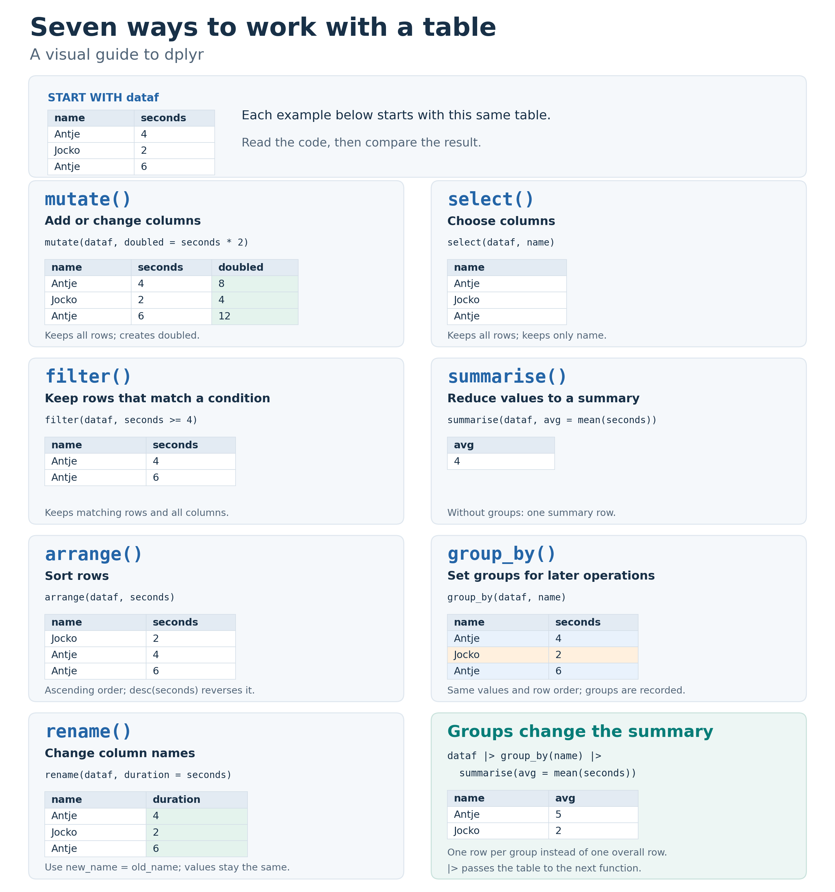

## A basic example using group_by() and summarize()

```{r}
library(tidyverse)
data(iris) #may need to change
#For each species, find sample size, avg sepal width, standard deviation of sepal width, in new dataframe
iris %>%
  group_by(Species) %>%
  summarize(
    sample_size = n(),
    avg_sepal_width = mean(Sepal.Width),
    sd_sepal_width = sd(Sepal.Width)
  )
```

## Contrast between base R and Tidyverse

Example: Find the mean of each unique vocalization type, create a new dataframe containing only data from Jocko.

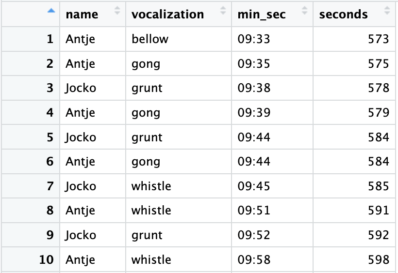

```{r}

dataf <- read.table("walrus_sounds.tsv", header = F, sep = "\t")
colnames(dataf) <- c('name', 'vocalization', 'min_sec')
sec1 <- as.numeric(str_split_i(dataf$min_sec, ':', 1))*60 
sec2 <- as.numeric(str_split_i(dataf$min_sec, ':', 2))

#Base R
dataf$seconds <- sec1+sec2
mean_by_group_baseR <- aggregate(seconds ~ name + vocalization, data = dataf, FUN = mean)
mean_by_group_baseR_jocko <- mean_by_group_baseR[mean_by_group_baseR$name == 'Jocko',]
jocko_seconds <- mean_by_group_baseR_jocko$seconds

#Dplyr
mean_by_group_dplyr_jocko <- dataf %>%
    mutate(seconds = sec1+sec2) %>%
    group_by(name,vocalization) %>%
    summarize(Mean_seconds = mean(seconds)) %>%
    filter(name=="Jocko") %>% 
    as.data.frame()

#if you want to extract a column into a vector, use pull()
jocko_seconds <- mean_by_group_dplyr_jocko %>% pull(Mean_seconds)

```

We sent the same dataframe into a series of base R manipulations on the one hand, and into a dplyer pipe expression on the other. What we ended up with were a dataframe for the one output and a tibble for the other output. You should realize that a tibble is different from a dataframe, although I won't get into exactly how. However, a tibble is the dataframe structure used in the tidyverse, and it will not behave like a dataframe when attempting to use base R functions on it. To convert back to a dataframe run the following: as.data.frame(tibble_df).

### Last task: Pivoting a dataframe for plotting

In order to prepare data for easier use with ggplot2, it is necessary to convert data format from wide to long. In long format, the numerical data is present in only one column.

**Wide format:**

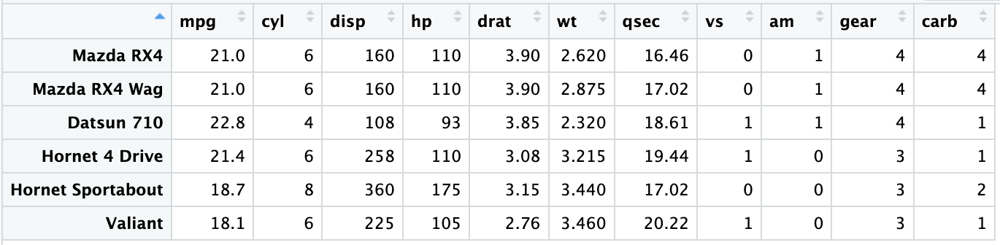

**Long format:**

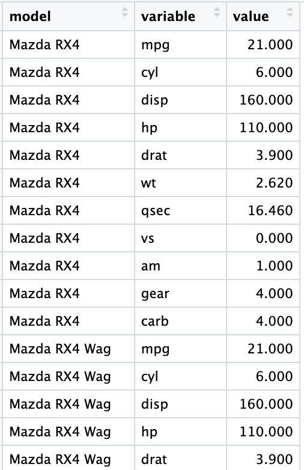

Tidyverse:

```{r}
library(tidyverse)
head(mtcars) # the tidy verse comes with the mtcars data preloaded

mtcars_wide <- mtcars
mtcars_long <- mtcars_wide %>%
    rownames_to_column(var = "model") %>% 
    pivot_longer(
        cols = -c(model), # Select all columns except 'model' to pivot
        names_to = "variable", # New column for the original column names
        values_to = "value" # New column for the values from the original columns
    )
```

R (using reshape from data.table library):

```{r}
#| eval: false
library(data.table)
mtcars_sub$model <- rownames(mtcars_sub)
mtcars_long <- melt(
  data.table(mtcars_sub),  
  id.vars = c("model", "mpg"), 
  variable.name = 'variable', 
  measure.name =  colnames(mtcars_sub)[colnames(mtcars_sub) != 'mpg'] 
  )
```

## The power of ggplot2

### A simple bar plot

```{r}
ggplot(mtcars, aes(x = cyl)) +
    geom_bar(fill = "steelblue", color = "black") +
    labs(title = "Number of Cars by Cylinder Type",
         x = "Number of Cylinders",
         y = "Count") +
    theme_minimal()
```

### With more complicated plots, it's better to pivot the data

```{r}
mtcars <- datasets::mtcars #recover original dataset (we modified it above)
mtcars_long <- mtcars %>%
      rownames_to_column(var = "model") %>% # Convert row names (car models) to a column
      pivot_longer(
        cols = -c(mpg, model), # Select all columns except 'model', 'mpg' to pivot
        names_to = "variable", # New column for the original column names
        values_to = "value" # New column for the values from the original columns
      )
      
ggplot(mtcars_long, aes(x = mpg, y = value, color = variable)) +
      geom_point() +
      facet_wrap(~ variable, scales = "free_y") + 
      labs(title = "mpg vs. variables", x = "Miles Per Gallon (mpg)", y = "Value") +
      theme_minimal()
```

### Filter before adding labels and plotting

```{r}
library(ggrepel)
mtcars_long %>% 
    filter(variable %in% c("wt")) %>% 
    ggplot(aes(x = mpg, y = value, color = variable, label = model)) +
    geom_point() +
    facet_wrap(~ variable, scales = "free_y") + 
    labs(title = "mpg vs. variables", x = "Miles Per Gallon (mpg)", y = "Value") +
    theme_minimal() +
    geom_text_repel()
```

## Example of using left-join

```{r}
left_data <- head(iris) %>% 
    mutate(id = row_number()) # Create an ID column for merging
right_data <- tibble(
    id = c(1, 2, 99), # 1 and 2 match; 99 does not
    Sunlight_Hours = c(8, 6, 10),
    Soil_Type = c("Loamy", "Clay", "Sandy")
)

# left join
merged_data1 <- left_join(left_data, right_data, by = "id")
# right join
merged_data2 <- right_join(left_data, right_data, by = "id")
# left join
merged_data3 <- full_join(left_data, right_data, by = "id")
```

### More on joining

Full (outer):

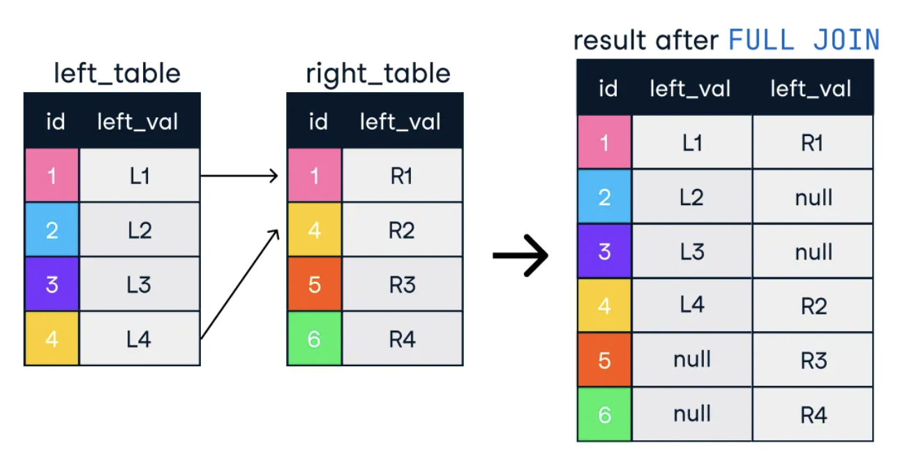

Inner:

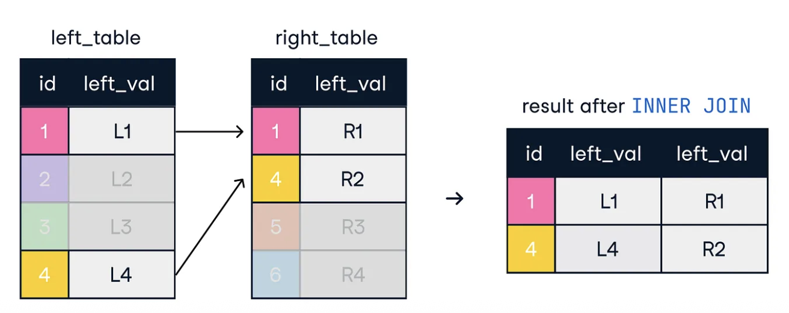

Left:

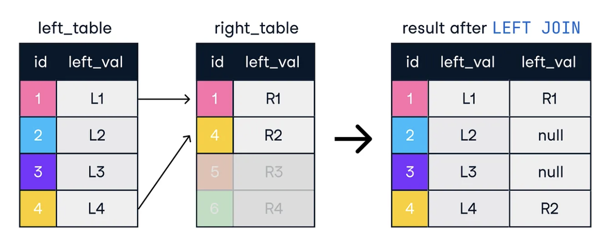

Right:

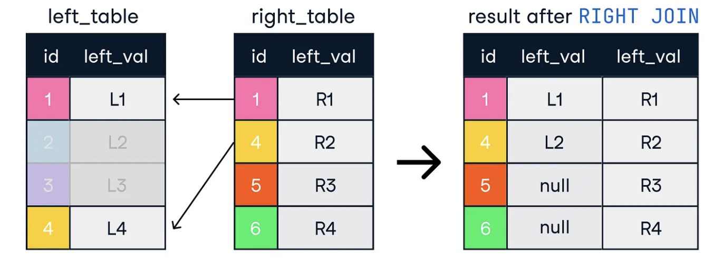

Note an error with this last figure: the second line of the last result table should read: 4 \| L4 \| R2

Debugging

```{r}
browser()

run_it <- function(){ 
  browser()
  out_vect <- c() 
for (i in 1:10){
  for (j in letters[1:5]){
    out_vect <- c(out_vect, paste0(i,j, sep=','))
  }
}
}
run_it()
```
