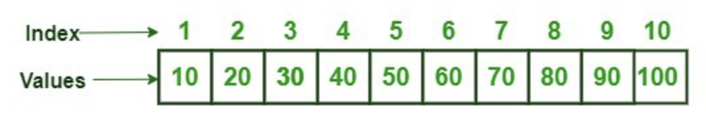

## Introduction to R

R and RStudio (RStudio is an 'IDE', integrated development environment), together constitute one of the most popular tools used by researchers to analyze big data. Because it was first designed by statisticians for statistical purposes, R is a really nice language for data science.  Wrangling massive amounts of information and producing publication-ready graphics and visualizations are more straightforward with R than other languages, and its use in data science remains strong. 

R was created in the early 1990s by University of Auckland statisticians Ross Ihaka and Robert Gentleman. Ihaka and Gentleman, "identified what they called a common need for a better software environment" which lead them to first develop R based on a language called "S". They started working on R in the early 90s, but version 1.0.0 wasn't released until February 2000.  So it's about 25 years old, officially.

{width="440"}

 R is an  open-source language, which means that anyone can contribute, and the course of its development is based on the collaborative effort of many many people.

The scope of R is vast, with many packages and data structures. However, you will come to use specific packages, and the ones you use most often will become very familiar to you over time, like old friends. This course will develop your skills in base R, which will allow you to strike out into the world and make new friends.

R is an interpreted language, which means that users access its functions through a command-line interpreter. We will be using the RStudio IDE, but lets first see what it's like to use R at the command line.

 Type R. into your terminal, and run a couple of "calculator" commands.

```{r}
3+2*4
5^5
```

 Define an object with the name 'animal', return the object value.

```{r}
animal <- "elephant"
animal
```

But we will not be using R from the terminal, we will be using the RStudio IDE. What you see here, however, is actually an Rmd file that is layered over the standard R editor (in order to allow more formatting). So lets take a short detour over to a more standard setup that you will be using outside of this course.

 

## **More information/Resources**

[RStudio user guide](https://docs.posit.co/ide/user/)

# RStudio orientation

## RStudio panes

The large window (aka pane) on the left is the **Console** window. If you open or create a file, it is placed in the **Source** window, generally to the top left. The window on the top right is the **Environments** window (**Environment / History / Connections**) and the bottom right window is the  **Output** window (**Files / Plots / Packages / Help / Viewer**). We will discuss each of these panes in turn below.

You can customise the location of each pane by clicking on the 'Tools' menu then selecting Global Options --\> Pane Layout. You can resize the panes by clicking and dragging the middle of the window borders in the direction you want.

 

To set up RStudio to run the current line by pressing \<`CTRL`\>\<`ENTER`\>, go to tools -\> global options\
-\> code. Set the `Ctrl+Enter executes` option to `current line`. I recommend doing this !

 

**Console**

The Console is where R evaluates all the code you write. You can type R code directly into the Console at the command line prompt, `>`. You can also highlight sections of code and press \<`Ctrl`\>\<`Enter`\>. To highlight a line, click its number to the left, and to then highlight multiple lines, drag your mouse down or up.

### **Environment/History/Connections**

The Environment / History / Connections window shows you lots of useful information. You can access each component by clicking on the appropriate tab in the pane.

- The 'Environment' tab displays all the objects you have created in the current (global) environment. Drop-down/list

- The 'History' tab contains a list of all the commands you have entered into the R Console.

- The 'Connections' tab allows you to connect to various data sources such as external databases.

### **Files/Plots/Packages/Help/Viewer**

- The '`Files`' tab lists all external files and directories in the current working directory on your computer. It works like file explorer (Windows) or Finder (Mac). You can open, copy, rename, move and delete files listed in the window.

- The '`Plots`' tab is where all the plots you create in R are displayed (unless you tell R otherwise). Zoom/scroll/export

- The '`Packages`' tab lists all of the packages that you have installed on your computer. You can also install new packages and update existing packages by clicking on the 'Install' and 'Update' buttons respectively.

- The '`Help`' tab displays the R help documentation for any function.

# System and packages

## **Packages**

You can think of a package as a collection of functions. There are three main sources of packages: CRAN (Comprehensive R Archive Network), Bioconductor, Github.

The base installation of R comes with many useful packages as standard. These packages will contain many of the functions you will use on a daily basis. However, as you start using R for more diverse projects (and as your own use of R evolves) you will find that there comes a time when you will need to extend R's capabilities

There are different ways to load packages. Most of the packages we need are already present in your RStudio environment. For example, you can load the stringr package, because it is already installed (library(stringr)). Try to load the mmcards library (it is not yet installed):

```{r}
library(mmcards)
?shuffle_deck
```

 

## **CRAN packages**

To install a package from CRAN you can use the `install.packages()` function. The mmcards package is not currently installed. If you want to install the `mmcards` package (which allows installations from GitHub), enter the following code into the Console window of RStudio (note: you will need a working internet connection to do this). Now check your local library on the command line.

```{r}

install.packages('mmcards', dependencies = TRUE)
library(mmcards)
game_deck <- shuffle_deck()
```

 

You may be asked to select a CRAN mirror, just select '0-cloud' or a mirror near to your location. The `dependencies = TRUE` argument ensures that additional packages that are required will also be installed.

It's good practice to occasionally update your previously installed packages to get access to new functionality and bug fixes. To update CRAN packages you can use the `update.packages()` function.

```{r}

update.packages(ask = FALSE)
```

 

The `ask = FALSE` argument avoids having to confirm every package download.

## **Bioconductor packages**

To install packages from Bioconductor the process is a [little different](https://cran.r-project.org/web/packages/BiocManager/vignettes/BiocManager.html). You first need to install the `BiocManager` package. You only need to do this once unless you subsequently reinstall or upgrade R. We don't need to run any of this code, because all of these packages are already installed.

```{r}

install.packages('BiocManager', dependencies = TRUE)
```

 

Once the BiocManager package has been installed you can either install all of the 'core' Bioconductor packages with

```{r}

BiocManager::install()
```

 

or install specific packages such as the 'GenomicRanges' and 'edgeR' packages.

```{r}

BiocManager::install(c("GenomicRanges", "edgeR"))
```

To update Bioconductor packages just use the `BiocManager::install()` function again.

```{r}

BiocManager::install(ask = FALSE)
```

Again, you can use the `ask = FALSE` argument to avoid having to confirm every package download.

## **GitHub packages**

There are multiple options for installing packages hosted on GitHub. Perhaps the most efficient method is to use the `install_github()` function from the `remotes` package (you may need to install the 'remotes' package first ( install.packages('remotes') ). Before you install, you will need to know the GitHub username of the repository owner and also the name of the repository. For example, the development version of `dplyr` from Hadley Wickham is hosted on the tidyverse GitHub account and has the repository name 'dplyr' (just Google 'github dplyr'). To install this version from GitHub, use

```{r}
remotes::install_github("tidyverse/dplyr")
```

The safest way to update a package installed from GitHub is to just reinstall it using the above command.

## **Using packages**

Once you have installed a package onto your computer, it is not immediately available for you to use. To use a package you first need to load the package by using the `library()` function. For example, to load the mmcards package you previously installed.

```{r}
library(mmcards)
```

Sometimes it can be useful to use a function without first using the `library()` function. If, for example, you will only be using one or two functions in your script and don't want to load all of the other functions in a package then you can access the function directly by specifying the package name followed by two colons and then the function name. This is why we used the following command above to install from github

```{r}
detach("package:mmcards", unload = TRUE) #this detaches the library
shuff_deck <- shuffle_deck() # you will see an error message
shuff_deck <- mmcards::shuffle_deck()
```

 

This may seem a bit confusing at first, but managing packages will become second nature after using R for a short while. In addition, if you are following a manual or a vignette (a short tutorial) for a specific tool, the packages will all be listed at the top, and there is no extra knowledge needed about packages in order to get going with analysis (in most cases). Just ask the internet how to install a package and the answer is almost always correct.

## **File Orientation**

### **Working directories**

The working directory is the default location where R will look for files you want to load and where it will put any files you save. You can check the file path of your working directory by looking at bar at the top of the Console pane.

If we were using a project, the home directory would be associated with the project name. For this class, we will not be working with projects, since we are just getting oriented to the RStudio IDE. 

```{r}
getwd()
```

 

Examples of ways that R can interact with the underlying file system.

 

```{r}
#to list files in current directory
list.files()
#to create a directory in the file system
dir.create('test_dir')
list.files()
```

 

### Naming R files

Although there's not really a recognized standard approach to naming files, there are a couple of things to bear in mind.

First, avoid using spaces in file names by replacing them with underscores or hyphens. One reason is that some command line software (especially many bioinformatic tools) won't recognize a file name with a space which creates numerous problems. For the same reason, also avoid using special characters (i.e. \@£\$%\^&\*(:/) in your file names.

Avoid using the word *final* in any file name - it rarely is!

Whatever file naming convention you decide to use, try to adopt early, stick with it and be consistent.

# Coding basics

## **Coding in R**

### Some guidelines:

- R is case sensitive.

- Anything that follows a `#` symbol is interpreted as a comment and ignored by R. Annotate heavily!! Your future self will be happier.

- In R, commands are generally separated by a new line. You can also use a semicolon `;` to separate your commands on the same line but this is rarely done.

- If a continuation prompt `+` appears in the console after you execute your code this means that you haven't completed your code correctly. This often happens if you forget to close a bracket. Either try to finish the command on the new line, or hit escape on your keyboard until the console resets.

- In general, R allows extra spaces inserted into your code, in fact using spaces is actively encouraged. However, spaces should not be inserted into operators i.e. `<-` should not read `< -` (note the space)

- If your console 'hangs' and becomes unresponsive, try pressing the escape key (esc) or clicking on the stop icon in the top right of your console. This will terminate the current operation in most cases.

### R as a calculator -The R REPL (read evaluate print loop)

- In the code below, operators and functions are used

```{r}
2+2
log(1)             # log base e
log2(1)            # log base 2
exp(1)             # e^x
sqrt(4)            # square root
4^2                # 4 to the power of 2
pi                 # not a function but useful
17%%6              # modulo operator
                    # Order of operations, options(digits = 10)
```

### **Objects, Variables, Datatypes**

Objects are the central concept that unites R. Everything in R can be thought of as an object.

Examples of objects include: a single number, a character string (like a word), a vector, a data table, or a highly complex plot or function. Understanding how you create objects and assign values to objects is key to understanding R.

To create an object we simply give the object a name. We assign a value to this name using the *assignment operator* `<-`. The assignment operator is a composite symbol comprised of a\
'less-than' symbol `<` and a hyphen `-` .

```{r}
my_obj <- 5
```

In the code above, we created an object called `my_obj` and assigned it a value of the number `5` using the assignment operator. You can also use `=` instead of `<-` to assign values. Some people do this, but it is considered bad practice.

To view the value of the object, enter the name of the object in the console, or execute it from the IDE \<`CTRL`\>\<`ENTER`\>.

```{r}
my_obj
```

``` text
## [1] 5
```

 

Check 'Environment' tab for the object.

If you click on the down arrow on the 'List' icon in the same pane and change to 'Grid' view RStudio will show you a summary of the objects including the type (numeric - it's a number), the length (only one value in this object), its 'physical' size and its value (5 in this case).

 

### **Naming objects**

Naming your objects in R is important. Good object names should be short and informative. If you need to create objects with multiple words in their name then use either an underscore or a dot between words, or capitalise the first letter of new words. I prefer using underscores ([*snake case*](https://en.wikipedia.org/wiki/Snake_case)).

The examples below show how to assign a variable name to a character string.

```{r}
input_argument_last <- "cell type 1"
```

```{r}
input.argument.last <- "cell type 1"
```

```{r}
inputArgumentLast <- "cell type 1"
```

 

Code break: Create some additional objects

Write some code in the Source window, and execute it \<`CTRL`\>\<`ENTER`\>. Use the mathematical operators above, and create objects by assigning variable names.

```{r}

num_1 <- 33
char_1 <- "don\'t think so!"
num_2 <- num_1 / 2
num_4 <- 1 + num_2
#num_5 <- num_1 + char_1
num_4
num_4 = char_1 + 1
num_4
```

When learning R, understanding errors and warnings can be frustrating (what's an argument or a 'binary operator' ?). To find out more information about a particular error, Google a version of the error message, e.g. 'non-numeric argument to binary operator error + r' .

### **'Base R' Functions**

There are many functions, operators, and objects already available in R distributions. These are referred to as 'base R' functions, 'base R' operators, etc. Functions are R objects that take an argument, carry out some operations, and typically return a value.

For example, the log() call made above used the log() function. It also takes other arguments, such as the base of the logarithm that you may want to use.

 To get help for a function, type a question mark before the name of the function and execute it.

```{r}

?log
```

 

### Character objects

Numbers are pretty easy to understand in R, and they generally behave as expected. Characters and manipulation of character strings, however, may not be so intuitive to beginners in programming, so lots look at the variety of manipulations possible for the object type character.

**Quoting**

```{r}
# A string must start and end with the same type of quote.
message <- "Hello"
message <- 'Hello'

# Double quotes can contain single quotes.
message <- "The AI's brain glitched"

# Single quotes can contain double quotes.
message <- 'The AI said, "Kneel before me!"'

```

**Pasting**

```{R}
samples <- c("wild_type", "mutant", "control")

paste0(samples, ".csv")
paste(samples, "csv", sep='.')

# [1] "control.csv" "treated.csv" "blank.csv"
```

Creating character vectors

```{r}
file_names <- c("sample 1.csv", "sample 2.csv", "sample 3.csv", "sample 4.csv")
file_names_2 <- paste0(rep('sample_', 10), 1:10)
file_names_2

nchar(file_names)

```

Clean up names

```{R}

label <- "  wild type  "
label <- trimws(label)
label <- gsub(" ", "_", label, fixed=TRUE)
label

#Alternate
label <- "  wild type  "
gsub(" ", "_", trimws(label), fixed=TRUE)

```

### **First look at the vector in R.**

We used a vector to hold a few character strings above. The c() function is short for concatenate and we use it to join together a series of objects and store them in a data structure called a **vector.**

```{r}
my_vec <- c(2, 3, 1, 6, 4, 3, 3, 7)
```

 

A vector is like a one-dimensional container that holds a series of elements, all of the same type -- for example, a vector of numbers, or a vector of character elements. Although vectors are a data structure, they are considered to be a fundamental object type because vectors constitute other common data structures (like dataframes).

#### Code Break: Introduction to vectors

Once we've created a vector, we can use other functions to get information about this object. For example, we can calculate the mean, variance, standard deviation and number of elements in our vector by using the\* `mean()`*,* `var()`*,* `sd()` *and* `length()` \*functions. Call these functions on the vector to see what happens.

```{r}
my_vec <- c(2, 2, 3, 9, 4, 5)
typeof(my_vec)

#your code here:


```

#### Exploring vectors with seq(), rep(), and sample()

Some code for creating and manipulating vectors is given below. Play with the code, or make your own and try to understand what is happening. If you want to read about the functions, type a question mark followed by the function name.

```{r}
#The seq() function
seq(1,20)
seq(1,20,.1)
length(seq(1,20))
c( seq(1,10), seq(20,30) )
#The rep() function
c( rep(1, 10), rep(2,10) )
rep("abc", 10)

#query the sample function (?sample), and try to use it 
#query the rnorm function, and try to use it

#your code here:


```

In R, to "unset" or remove a variable from your environment, you can use the `rm()` function.

#### Functions typically act on both indiviual objects AND vectors.

An example of file names is given below. Use the same commands as above (trimws, gsub) to change each element of the vector.

```{R}
samples <- c("  wild type", "mutant  ", "  control  ")

#your code below for trimws and gsub


```

 

The next section focuses on extracting or altering elements of vectors.

**Vectors and extracting elements**

- The way to 'index' a vector is by using brackets `[ ]` .
- This syntax is common to vectors and also to lists



By positional indices

```{r}

my_vec <- c(2, 2, 3, 9, 4, 5)
my_vec[3]                       #extract single element
my_vec[3:8]                     #extract a range of elements
my_vec <- my_vec[c(3,4,5,6,1,2)] #re-order elements of a vector note 'NA'
#Not this:
my_vec <- my_vec[3,4,5,6,1,2]    #the extraction operator [] expects a vector
```

change
