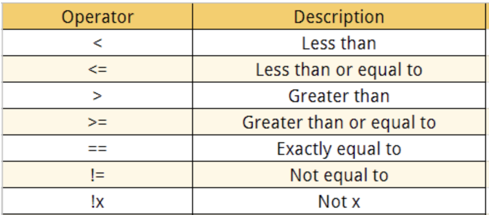
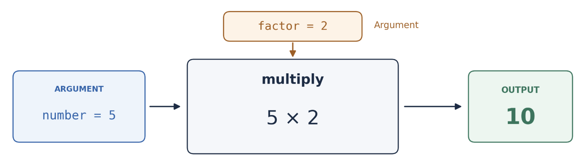

# Part 2 - Coding proper

## Re-Entry into R

At this point, we have come into contact with a few object types and a data structure in R (i.e., numeric, character, boolean, vector).

We've also learned how to interact with a vector using functions and by **indexing** elements.

 Until now, however, we've been using with these objects without fully appreciating their place in the range of objects in the R language.  This was intentional, because gaining some familiarity with objects and how they interact from a more intuitive standpoint is a good background to have for what comes next.

## The bigger picture

+-----------------------------+-------------------------------+
|                             |                               |
+=============================+===============================+
| Object types to be covered  | Data Structures to be covered |
+-----------------------------+-------------------------------+
| - Numeric (integer, double) | - Vectors                     |
|                             |                               |
| - Character                 | - Lists                       |
|                             |                               |
| - Logical                   | - Dataframes                  |
|                             |                               |
|                             | - matrix\*                    |
+-----------------------------+-------------------------------+

We will re-enter coding in this section, beginning again with the vector, but in greater depth. Here we will encounter most of the basic object types as individual elements of these vectors. We will then discuss lists, and move on to dataframes as quickly as possible, since it is the dataframe where the power of R is best leveraged.

There are four primary types of atomic vectors: logical, integer, double, and character*.*

Have a go at creating some of them. Then use the function typeof() to check their type.

*Code*:

```{r}
num_1 <- c(10:12)
num_2 <- c(1:10)/3
char_1 <- c('coding', 'region')
logical_1 <- c(T,F,F)

```

 

### Coercion

Even though R vectors have a specific type, it's quite easy to convert them to another type. This is called **coercion**. This flexibility works mostly to our advantage; for example, we generally don't worry about whether a vectors is an integer versus double in R, and just consider them to be numeric. But unexpected coercion can cause confusing errors to arise, so always consider this possibility when coding.

For explicit coercion, use the as.xxxxx() functions.

```{r}
v_log <- c(TRUE,FALSE,FALSE,TRUE)
an_int <- as.integer(v_log)
a_num <- as.numeric(v_log)
a_char <- as.character(v_log)
a_log <- TRUE
#Use class() or typeof() to look at each of these variables


#Convert a_log to an integer, then to a character


```

 

Warning: implicit coercion

Coercion can also be triggered by other actions, such as assigning an element of a different type into an existing vector.

 

```{r}
num_vect <- c(1:10)
num_vect <- c(num_vect, 'string')
num_vect
num_4 <- as.integer(c(1:10, 1.3))
```

 

Our numeric vector was silently coerced to character in one case, and in the other, the number was rounded. Notice that R did this quietly, without warning. Always pay attention to the questions: Is this object of the type I think it is? How sure am I about that?

 

### **Logical operators, and booleans**

- Logical operators which compare values and create boolean outputs produce the underlying logic that will allow you to interact with objects like vectors and dataframes (tables).

- The boolean outputs produced by logical operators allow you to slice, modify and remove elements contained in vectors, lists, and dataframes.



#### Code break:

1.  Test a numerical vector with the above operators using a number (vec \< 1), and look at the output.

2.  Vectorization: Create another vector and see how the operators behave when comparing two vectors. (You must use vectors of the same length.)

Examples (create your own underneath the examples)

```{r}
#examples
v1 <- c(2, 2, 3, 9, 4, 5)
n1 <- 5
v1 < n1
v1 <= n1
v2 <- 1:12 #can use the colon alone to create vectors!
v3 <- rev(5:16)
v2 < v3
v2 == v3

#your code here:


```

**Extraction of elements using booleans**

We used `[ ]` above to slice elements, but boolean vectors also can be used to slice out elements. Only the indices where `TRUE` occurs will be extracted, and indices where `FALSE` occurs will be ignored. Here is an example.

```{r}
vect1 <- c(1:10)
vect2 <- c(rep(TRUE, 3), rep(FALSE, 7))
vect2
vect1[vect2]
```

In the code below, try to predict what the sub_vector will look like, before executing that line.

```{r}
vv = c(1:3, 10:16, -5, 2) #note the shorter way to create number ranges !
vv
sub_vector <- vv[vv < 12]
sub_vector

```

**Challenge**

Use a simple expression to find the element that is equal at the same position in the following two vectors?

```{r}
my_vec1 <- 1:11 
my_vec2 <- rev(5:15)

```

**Booleans with logical operators** `&`, `|`, **and** `!` .

```{r}
vect1 <- c(T,T,T,F,F,F)
vect2 <- c(T,T,F,F,F,T)
vect1 & vect2
vect1 | vect2
vect1 & !vect2

```

Test what will happen if the boolean vector is shorter. Make a boolean vector b1 that has 3 boolean values and use it to index v1. What is going on!

```{r}
v1 <- 1:10 #not this additional way to create a numeric vector !
b1 <- 

#index v1 with b1, and observe the behavior


```

**Vectorization**

We have been using vectorization without having really discussed it in depth. One of the great things about R functions is that most of them are vectorized. This means that the function will operate on all elements of a vector without needing to apply the function on each element separately. This will become even more useful when manipulating data tables.

```{r}
c(1:10) + c(21:30)
c(1:10) / c(21:30)
c(1:10) %% c(21:30)
before <- c(100, 150, 200)
after  <- c(120, 135, 250)
change <- after - before
percent_change <- (after - before) / before * 100

```

### Lists

Lists are needed for holding elements that violate the constraints required of atomic vectors, i.e., if one or both of the following are true. Note: lists are also technically a type of vector.

- An element of the list has length greater than 1.

- The individual elements to be collected together are not of the same type.

 

Lists are a more general form of a vector. Whereas a vector must contain elements that are all the same object type, the elements of a list may be various types. Lists are also commonly created when you want to name each element and refer to these elements by their names, rather than index. However, lists need not have explicit names.\

There are three common ways to create a list from scratch:

1.  Provide the element names together with the elements of the list

```{r}
list1 <- list(element1 = 1, element2 = c(2,3,4), element3 = T)
```

2.  Create a list and then provide the names as a vector.

```{r}
list1 <- list(1, c(2,3,4), T)
names(list1) = c("element1", "element2", "element3")
```

3.  Convert some other object to a list

```{r}
a_vect <- c(11:20)
a_list <- as.list(a_vect)
```

Add to a list

```{r}
list1$element4 <- 9
list1[['element5']] <- 10
```

R's expressions for nested lists: carefully note how the console represents these.

```{r}
list1 <- list(1, c(2,3,4), T)
names(list1) = c("element1", "element2", "element3")
list1$element4 <- list(1,2)
names(list1$element4) <- c('sub1', 'sub2')
list1[['element5']] <- list(list(3), list(4,5))
#note on spaces in list names
```

***Take note!***:

What is going on with the following two commands? They produce different objects.

```{r}
#Two different methods of list generation that are not the same
vect1 <- list(c(5:10))  
vect2 <- as.list(c(5:10)) 
```

**Indexing a list**:\
With vectors, we used brackets [] for indexing by position.\
With lists, the elements can be indexed in three ways, all of which are very important to understand.

1.  Single brackets (returns a list of the selected element or elements)

```{r}
list1 <- list(name1 = 1, name2 = c(2,3,4), name3 = T, name4 = NA)
list1[2] #returns same type as 'parent' type
#or
list1['name2']
```

2.  Double brackets (returns the element indexed)

```{r}
list1 <- list(element1 = 1, element2 = c(2,3,4), element3 = T)
list1[[2]] #returns the element itself
#or
list1[['name2']]

```

3.  Dollar sign syntax (`$<element name>) (returns the element indexed)`

```{r}
list1$element2 #returns the element itself
```

Question: how do we know the output is a list in the above 3 cases.

By the way, a vector can also have element names! However, note the format when R prints out the object. Also, the vector's elements cannot be 'directly' indexed by their names.

```{r}
a_named_vect <- c(5:10)
names(a_named_vect) <- letters[1:6]
a_named_vect
```

 

## Some additional tools

**stringr**: The stringr package contains many functions for string operations. These functions are much easier to use than R's default functions, and I highly recommend them.

```{r}

library(stringr)
library(glue)
str1 <- c("Hello", "hello.there", "hi", "ahoy", "nope")

#tests for a pattern
str_detect(str1, 'he') | str_detect(str1, 'op')  

#splits at a pattern, and selects which 'split' to keep
str_split_i(str1, 'll', 1) 
str_split_i(str1, 'll', 2) 

#paste together strings (like paste0)
str_c("Hello ", "there") 

#count number of occurrences
str_count(str1, "He|[.]") #!


#glue objects and characters together instead of paste0
name <- "Alice"
age <- 30
statement <- glue("My name is {name} and next year I will be {age + 1}.")
statement

```

 

#### Coding exercises for strings

**exercise 1**

- a vector of sample names is presented below. Use the stringr functions and glue() to do the following tasks.

  1.  Use `str_split_i()` to extract the gene names and tissues into separate vectors.

  2.  Use `str_detect()` to identify gene names containing `"BRCA"`.

  3.  Use `glue()` to create summaries for each sample as follows:

      BRCA1 was measured in breast tissue

      TP53 was measured in lung tissue

      BRCA2 was measured in breast tissue

      EGFR was measured in lung tissue

      TP53 was measured in liver tissue

```{r}
library(glue)
samples <- c("BRCA1:breast", "TP53:lung",
             "BRCA2:breast", "EGFR:lung", "TP53:liver")
gnames <- str_split_i(samples, ':', 1)
tnames <- str_split_i(samples, ':', 2)
output <- glue('{gnames} was measured in {tnames} tissue')
```

**exercise 2 (more advanced)**

- Given the short DNA sequences, do the following tasks:

  1.  Use `str_detect()` to collect sequences containing `"ATG"` in a vector.

  2.  Use `str_count()` to count occurrences of `"ATG"` in each sequence.

  3.  Use `str_count()` with the pattern `"G|C"` to count the total number of G and C bases in each sequence.

  4.  Use `glue()` to create summaries as follows for each ATG-containing sample:

      'Sample S1 contains 2 occurrences of ATG and 3 G or C bases.'

```{r}
sample_ids <- c("S1", "S2", "S3", "S4")
sequences <- c("ATGCCATG", "GGCCAATT",
               "ATGATGATG", "TTAACCGG")

```

#### Additional functions

**sample() and table()**: Sample from a vector; quickly tally number of appearances of each element in a vector

```{r}
#| eval: false
number_vect <- sample(1:10, 1000) # problem here
table(number_vect) # commonly used with hist() function
```

 

**rnorm()**: sample from a normal distribution

```{r}
?rnorm
rnorm(5,10,1) #note default arguments
```

 

**order()**: Sort a vector numerically or alphabetically. Note: returns the indexes of the vector used to sort the vector.

```{r}
set.seed(5) #note on seed
number_vect <- sample(1:10)
ordering <- order(number_vect, decreasing = T)
#What to do with this new ordering?

```

**%in%**: This strange-looking operator returns a boolean vector based on whether the elements of the first vector are found in the second.

```{r}
vect_1 <- c(1:20)
vect2 <- c(7:11)
vect1 %in% vect2
!vect1 %in% vect2
#write code below to select only elements in vect1 that appear in vect2


```

### Some loose ends: NA, NaN, Inf, -Inf

NA is the object that R uses to indicate 'not available', or 'missing'. It will incorporate itself into a vector and take the same data type as the elements around it when R needs to use it. Therefore, it is necessary to know for certain if your data contains NAs by testing using the function `is.na()`.

```{r}
a_vect <- c(1,-3,5,NA,7, NA)
typeof(a_vect[4])
is.na(a_vect)
sum(is.na(a_vect))
```

NaN is the object produce when there is no possible mathematical result for an operation, for example, when dividing 0 by 0, or when taking the square root of a negative number.

```{r}
a_vect/0
sqrt(a_vect)
is.nan(sqrt(a_vect))
sum(is.nan(sqrt(a_vect)))
```

We can see above how Inf, -Inf are produced when dividing by zero. Another common way that -Inf is produced is when taking the logarithm of zero

```{r}
log(rep(0, 5))
```

# Control Structures

### For-loops and conditionals

You've now been introduced to most of the basic R object types. We will be working with these objects now using `for` loops in order to develop some coding skills that are commonly used.

Note: R is very forgiving about lines and indentations, but there are some accepted standards.

```{r}
input = c(2,4,6,8)
for (i in input) { 
  print( (i)^.5 )
}

```

```{r}
input1 = 1:5
input2 = c(10,20,30)
for (i in input1) { 
  for (j in input2) {
    print(i*j)
  }
}

```

## **Conditionals: `if`, `else`**

Let's write a more complicated for-loop using if and else.

```{r}
for (i in 1:10) {
  if (i%%2 == 0) { 
    print(paste0(i, ' is even')) 
  } 
  else { 
    print(paste0(i, ' is odd'))  
  }
}

```

#If, else, and else if

```{R}
for (i in 1:10) {
  if (i%%2 == 0) { 
    print(paste0(i, ' is even')) 
  } 
  else if (i == 5) {
    print('halfway there!') 
  }
  else { 
    print(paste0(i, ' is odd'))  
  }
}
```

```{R}
# Experiment with Boolean operators below.
# Add an else if statement so that the code prints a response (like 'staying home').

temperature <- 10
is_raining <- TRUE

if (temperature > 25 & is_raining) {
  print("Won't need a jacket, but bring an umbrella!")
} else if (temperature < 15 & !is_raining) {
  print("Bring a jacket.")
} # Add another else if statement here.

```

Use of 'accumulators' with for loops

```{R}
odds <- c()
evens <- c()
for (i in 1:10) {
  if (i%%2 == 0) { 
    evens <- c(evens, i)
  } 
  else { 
    odds <- c(odds, i)
  }
}
evens 
odds
```

Use of 'incrementers' with for loops (and some debugging tips)

```{R}
dna <- "ACTCGNNCGGCTATT"
dna_v <- str_split(dna, "")
gc_count <- 0
for (base in dna_v){
  if (base == "G" | base == "C") {
  gc_count = gc_count + 1
  }
}
gc_count

```

### Code break

Use a for loop along with a condition test and an accumulator (in this case, a vector) to gather all query sequences that contain the query (look up and use the function str_find() ).

```{R}
sequences = c("ATGCGT", "ACGT", "TTAAGC", "ATCGCACG")
query = "ACG"
#your code here:


```

Read some more complicated code, and figure out why `next` (skips to the next iteration) and `break` (breaks out of the for loop and ends it) are used. This code is intended to check for a user, and send a message when that user is found.

```{R}
usernames <- c("alice", "", "bob", "carol", "", "dave")
target <- "carol"

for (user in usernames) {
  if (user == "") {
    next  
  }
  print(glue("Checking user: {user} \n"))
  if (user == target) {
    message <- glue('found {target}!, Stopping search\n')
    print(message)
    break
  }
}

cat("Done\n")

```

### **Functions**

A **function** is a reusable block of code. It can take **arguments** (inputs) and give back a **return value** (output).

**A function: arguments and output**



```{r}
multiply <- function (number, factor){
  return(number*factor)
}
multiply(5,2)
```

### **`function`** begins the function definition.

- **`multiply`** is the function’s name, assigned using `<-`.

- **`number`** and `factor` are arguments.

- The instructions enclosed in **`{ }`** form the function’s **body**.

- **`return()`** sends a value back to the code that called the function.

Why use functions?

- Avoid repeating yourself

- Break a big problem into small, named, testable pieces

### Try your own:

Create a function that takes in two vectors as parameters and multiplies them together using the `*` operator.

```{R}
#Your code here:


```

### Biological example

High quality nucleotides in a DNA sequence are indicated by upper-case letters and low quality nucleotides are indicated by lower-case letters. What is the following function doing? Read it, and figure it out based on the output. (Remember, vertical bar `|` in R denotes the logical 'or' operator.)

After you understand it, alter the function to output percentages of high quality and low quality bases in the sequence (rather than counts). Calculate precentages relative to the sequence length.

```{R}
quality_counts <- function(seq){
  highqual <- str_count(seq, "A|C|G|T")
  lowqual <- str_count(seq, "a|c|g|t")
  output <- c(highqual, lowqual)
  return(output)
}
inSeq <- ('ACGTacTGaaACACGTTGAGTacTGaaACGTacTGaa')
quality_counts(inSeq)
```

**A more complex function:**

Make a function that calls this function on each sequence from an input list of sequences. Output a list named by the sequences.

**Pseudocode**

Function input: list of sequences

Function output: list of percentage vectors

1.  Initialize accumulator list ( an empty list; my_list \<- list() ).

2.  For each sequence: call quality_counts .

3.  Add output fo quality counts in the list.

4.  Return the list.

```{R}
#To simply add an element to an empty list, use append() 
sequences = c("ATGCGC", "ATNNGC", "GGXXCTA", "ATATAT", "I'm invalid")
sequences <- append(sequences, list("CCC"))
sequences
```

```{R}
inSeq <- as.list( c(
'ACGTCGTTGAGTacTGaaACGTacTGaa', 
'ACGTacTGaaACACGTTGCCCGaaACGTacT', 
'ACGTacTGTGTGAGTacTGaaACGTacTGGG'
))
#your code here:
test_sequences <- function(seq_list){
  out_list <- list()
  for (i in seq_list) {
    #call the function we made here, and then add the result to out_list
  }
}

#don't forget a return statement!!

test_sequences(inSeq)

```

Named lists make objects more understandable.

The following adds a named element to a list: list[[seqName \<- sub

```{R}
sequences <- c("ATGCGC", "ATNNGC", "GGXXCTA", "ATATAT", "I'm invalid")
sequences <- append(sequences, list("TTTT"))
sequences

```

```{R}
inSeq <- as.list(c(
'ACGTacTGaaACACGTTGAGTacTGaaACGTacTGaa', 'ACGTacTGaaACACGTTGCCCTTGGGGGTGaaACGTacT', 'ACGTacTGTTTGGGGGTGAGTacTGaaACGTacTGGG'
))
names(inSeq) <- c('seq1', 'seq2', 'seq3')

test_sequences <- function(seq_list){
  out_list <- list()
  for (seqName in names(seq_list)) {
    sub_vect <- quality_counts(seq_list[[seqName]])
    out_list[[seqName]] <- sub_vect # another way to add to a list !
  }
  return(out_list)
}
gc_counts <- test_sequences(inSeq)


```

If that was too easy, with the sequences below, add a check in order to screen out any sequence that has an error in it (contains a nucleotide that is not ACGTNacgt). Use 'any means necessary' to get the answer, but try to understand it!

```{R}
sequences = c("ATGCGC", "ATNNGC", "GGXXCTA", "ATATAT", "I'm invalid")

#your code here


```

## Dataframes !

R is designed for handling data in the form of large tables, so this section is where we'll see the full power of R for data analysis. The underlying structure of a dataframe is just a list of vectors, so we already understand something about how to interact with dataframes.

**Slicing Dataframes**:

Slicing a dataframes means extracting specific rows and columns. This can be done in a number of ways in base R:

1.  Using list syntax (only for columns)

```{r}

dataf <- read.table("walrus_sounds_date_random.tsv", header = T, sep = "\t")
dataf[['vocalization']]
```

2.  Using numerical row and column indices:

```{r}

dataf <- read.table("walrus_sounds_date_random.tsv", header = T, sep = "\t")
dataf[3,2]
dataf[,2]
dataf[1,]
dataf[1:2,1:2]
```

3.  Using column names and row names

```{r}

dataf <- read.table("data/walrus_sounds_date_random.tsv", head = T, sep = "\t", fill=T, na.strings = "")
#colnames(dataf) <- c('name', 'vocalization', 'time_min_sec', 'date')
dim(dataf)
row_names_vect <- paste0(rep('row', 200), 1:200)
rownames(dataf) <- row_names_vect


#slice using column and row names
dataf[c('row3','row8'), c('name', 'time_min_sec')]
#slice using indices
dataf[3:8, 1:2] 
dataf[3:8,]
dataf[,-c(1,2)]
dataf[,-4]
#Note the difference between the following (picking out a single column returns a vector, but that behavior can be controlled)
dataf[,4]
dataf[,4, drop = FALSE]
```

**Adding a new column**

Convert the dataframe 'time_min_sec' column to total seconds, and create a new column called 'seconds'.

**Code challenge:**

Convert the dataframe 'time_min_sec' column to total seconds, and create a new column called 'seconds'. hint: first split the time column on the pattern ':', multiply the first split by 60 and add to second)

```{R}
#your code here
dataf$seconds <- as.numeric(str_split_i(dataf$time, ':', 1))*60 + as.numeric(str_split_i(dataf$time, ':', 2))
```

 

`ifelse` in R

The ifelse operator in R is widely used, and it's important to know it. It combines if and else with outputs. Here's an example.

We want to characterize vocalization length as short or long

```{R}
#your code here
mean_val <- mean(dataf$seconds)
dataf$voc_length <- ifelse(dataf$seconds < mean_val, 'short', 'long')

```

**Slicing dataframes using logical vectors**

Above, we have been selecting rows and columns using vectors containing the indices of the columns or rows or the names of the columns or rows.

Another and perhaps more important way to manipulate dataframes is to use logical vectors, whereby selection occurs only where TRUE appears in the vector.

Selecting rows using a test on a column vector

```{r}
dataf_Jocko <- dataf[,dataf$name == "Jocko"] #wrong!!
dataf_Jocko_chort <- dataf[dataf$name == "Jocko" & dataf$vocalization == 'chortle',]
mean(dataf$total_sec[dataf$name == "Jocko" & dataf$vocalization == 'chortle'])
```

Question: What is the following code accomplishing in extracting elements of the dataframe?

```{r}
mean(dataf$seconds[dataf$name == "Jocko" & (dataf$vocalization == 'chortle' | dataf$vocalization == 'gong')])
```

 

**Writing dataframes to files**

It's important to take analysis results from R and save them in a readable format. It is also important to use functions whenever possible in order to make your code modular.

Let's look at how to create a function to analyze dataframes, where this function also writes the results to new files. In this example, we will generate separate dataframes for each walrus, and write the dataframes to separate files in a new directory named for each walrus.

The input to the function will be the dataframe, and the function will find all walrus names, create a new column for seconds, and sorting in the previous manner. (We will then include writing of the data to a file. We will be using the base R function write.table(), which is the companion to read.table.)

```{r}
dataf <- read.table("data/walrus_sounds_date_random.tsv", header = T, sep = "\t")

separate_and_write = function(df_file_name) {
  dataframe_in <- read.table(df_file_name, header = T, sep = "\t")
  walrus_names <- unique(dataframe_in$name)
  for (wal_name in walrus_names){
    dataf_sub <- dataframe_in[dataframe_in$name == wal_name,]
    #your code here (add seconds column and column for long/short vocalization

    write.table(dataf_sub, paste0(wal_name, '_table.txt' ), quote = F, sep = '\t', col.names = T, row.names = F) 
  }
}
#Call the function below to test it

```

 

**Other functions that read/write dataframes**:

fread, fwrite (from data.table package)

Saving data without converting to a tabular format using `saveRDS()`

```{R}
saveRDS(dataf, 'dataf_fileName.Rds')
recovered <- readRDS('dataf_fileName.Rds')
```

**Be aware of numerous built-in R functions that will save you time**:

rowSums(), colSums(), cbind()

```{r}
vect <- rnorm(100)
dataframe <- as.data.frame(cbind(vect, vect, vect))
rowSums(dataframe)
colSums(dataframe)
```
