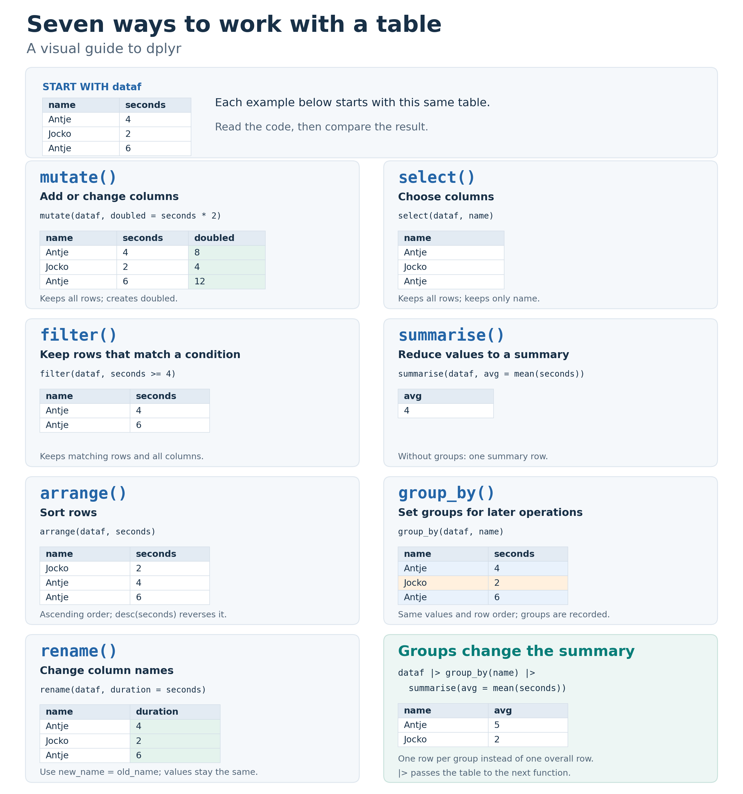
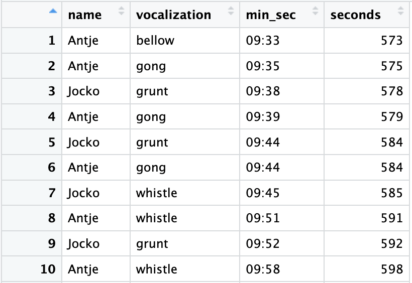
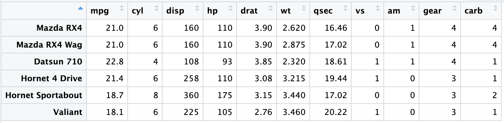
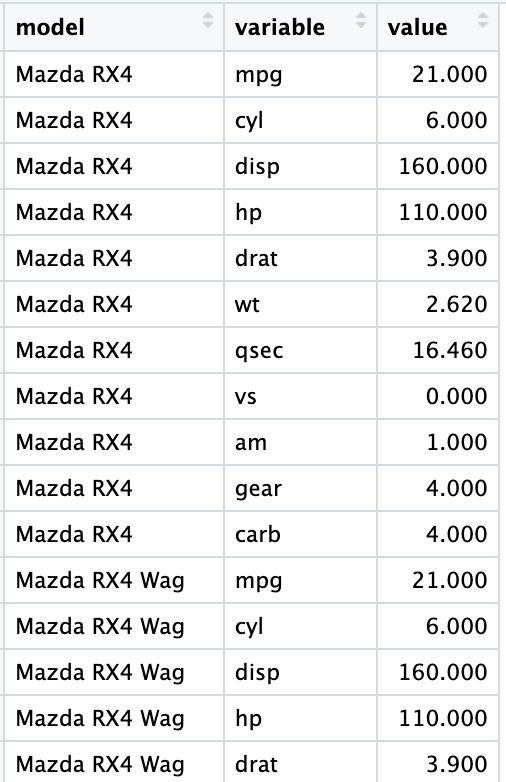
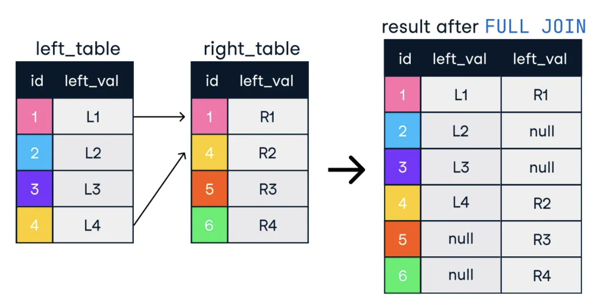
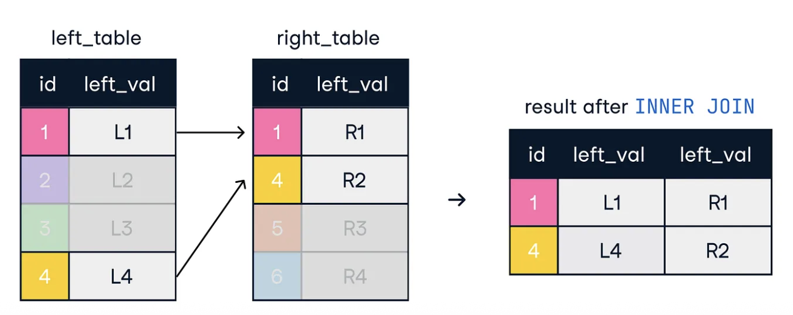
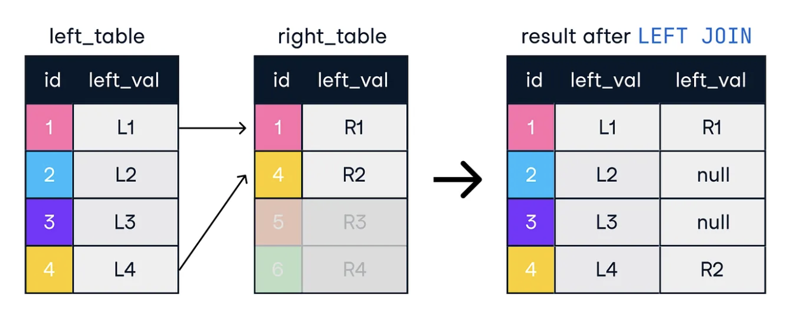
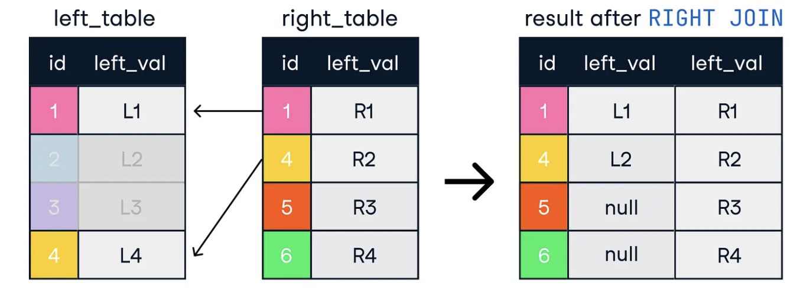

# Part 3 - Additional topics:

### The apply family functions

**lapply**: lapply is a convenient way to generate or modify a list of objects. It is similar to writing a for loop, but it takes less code. There are other 'apply' functions in R (e.g., **apply**, **sapply, mapply**), but we will stick with **lapply**. It is best to understand one of these apply functions before trying to use them all.

```{r}
generate_vect <- function(x){ return( rnorm(100, mean = x, sd = 3) ) }
list_of_vectors <- lapply(c(3,7,20), FUN = generate_vect)

input_num <- c(3,7,20)
names(input_num) = c('num1', 'num2', 'num3')


input_num <- c(3,7,20)
names(input_num) = c('num1', 'num2', 'num3')
list_of_vectors <- lapply(c(3,7,20), FUN = generate_vect)
```

### **Additional apply topics**

`sapply()`

**s**apply() will try to **s**implify the returned object. It will return:

A vector if the function applied to each element of the input returns a single value of the same type for all elements.

A matrix if the function applied to each element returns a vector of the same length for all elements. Each column of the matrix will correspond to the output for one element of the input.

A list if the simplification described above is not possible (e.g., if the function returns values of different types or lengths for different elements).

`apply()`

apply() is used in order to perform operations on each row (MARGIN = 1) or each column (MARGIN = 2) of a dataframe

```{r}
#sapply and apply
table_of_vectors <- sapply(c(3,7,20), FUN = generate_vect)
apply(table_of_vectors[1:3,], MARGIN = 1, function(x) {x[1] + x[2]})
```

 **Advanced topic: mapply**

```{r}

#mapply
# Define a function to annotate cars based on various columns
annotate_it <- function(mpg, wt, cyl, disp) {
  
  annot1 <- ifelse(mpg > 25 & wt < 2.5, "High Efficiency", "Low Efficiency") 
  annot2 <- ifelse(cyl > 4 & disp > 5, "Muscle Car", "Standard Power")
#  annot3 <- . . .
  annot <- paste(annot1, annot2, sep = ", ")
  return(annot)
}

# Apply the function across  the 'mpg', 'wt', 'cyl', 'disp' columns
mtcars$efficiency_class <- mapply(annotate_it, mtcars$mpg, mtcars$wt, mtcars$cyl, mtcars$disp)

# or better (since the function uses only vectorized operations!)

mtcars$efficiency_class <- annotate_it(mtcars$mpg, mtcars$wt, mtcars$cyl, mtcars$disp)

head(mtcars[, c("mpg", "wt", "efficiency_class")])
```

### Additional dataframe topics

**Creating a dataframe**

Method 1: from vectors, by column

```{r}
#generate vectors
vect1 <- c(1:10)
vect2 <- sample(c(20:25), 10, replace=T)
vect3 <- c(LETTERS[1:10], letters[1:10])
#create dataframe
df <- as.data.frame(cbind(vect1, vect2, vect3))
df$vect1 <- as.numeric(df$vect1)
df$vect2 <- as.numeric(df$vect2)
```

 

Method 2: from vectors, by row

```{r}
vect1 <- c(1:10)
vect2 <- sample(c(20:25), 10, replace=T)
vect3 <- str_c(LETTERS[1:10], letters[1:10])
df <- as.data.frame(rbind(vect1, vect2, vect3))
```

 

Method 3: from a named list, by column

```{r}
#generate list of vectors
generate_vect <- function(x){ rnorm(100, mean = x, sd = 3) }
list_of_vectors <- lapply(sample(5:10, 10, replace = T), FUN = generate_vect)
#provide names for the list
names(list_of_vectors) <- str_c(rep('vect', 10), rep('_', 10), c(1:10)) 
#create dataframe
df <- as.data.frame(list_of_vectors)
```

         \
         

# Tidyverse

Into the Tidyverse (just a bit)

## Base R vs. tidyverse

Until now, we have been coding mostly using 'base R' functions, along with functions from a few other packages. In this section, we will start working with the tidyverse package which is becoming increasingly popular in data science.

The tidyverse grammar follows a common structure in all of its functions. A set of verbs is used to facilitate the use of the functions, where the first argument is the object to be worked on.

Tidyverse is comprised of the following core packages:

|             |                                      |
|:------------|:-------------------------------------|
| **dplyr**   | Grammar for data manipulation        |
| **tidyr**   | Set of functions to create tidy data |
| **stringr** | Function set to work with characters |
| **readr**   | An easy and fast way to import data  |
| **forcats** | Tools to easily work with factors    |
| **ggplot2** | Grammar for creating graphics        |

## Pipe %\>%

The functions can be used independently, but with the aim of combining various functions, the pipe operator passes the output of one function to the input of the next. This way of combining functions allows you to chain several steps simultaneously. In the simple example below, we pass the vector to the mean() function.

```{r}
library(tidyverse)
vect1 <- str_c(1:100, rep(':', 100), sample(1000:2000, 100))
vect1 %>% str_split_i(':',2) %>% as.numeric() %>% mean()
```

## Table and vector manipulation

The dplyr package provides us with a data manipulation grammar, a set of useful verbs to solve common problems. The most important functions are shown below. Note that they are all named as recognizable verbs.

+--------------+------------------------------------------------+
|              |                                                |
+==============+================================================+
| **Function** | **Description**                                |
+--------------+------------------------------------------------+
| mutate()     | add new variables or modify existing ones      |
+--------------+------------------------------------------------+
| select()     | select variables, columns                      |
+--------------+------------------------------------------------+
| filter()     | filter (e.g., by row)                          |
+--------------+------------------------------------------------+
| summarise()  | summarize/reduce\                              |
|              | (Summarizes per group when used with group_by) |
+--------------+------------------------------------------------+
| arrange()    | sort                                           |
+--------------+------------------------------------------------+
| group_by()   | group (commonly in preparation for summarise)  |
+--------------+------------------------------------------------+
| rename()     | rename columns                                 |
+--------------+------------------------------------------------+



## A basic example using group_by() and summarize()

```{r}
library(tidyverse)
data(iris) #may need to change
#For each species, find sample size, avg sepal width, standard deviation of sepal width, in new dataframe
iris %>%
  group_by(Species) %>%
  summarize(
    sample_size = n(),
    avg_sepal_width = mean(Sepal.Width),
    sd_sepal_width = sd(Sepal.Width)
  )
```

## Contrast between base R and Tidyverse

Example: Find the mean of each unique vocalization type, create a new dataframe containing only data from Jocko.



```{r}

dataf <- read.table("walrus_sounds.tsv", header = F, sep = "\t")
colnames(dataf) <- c('name', 'vocalization', 'min_sec')
sec1 <- as.numeric(str_split_i(dataf$min_sec, ':', 1))*60 
sec2 <- as.numeric(str_split_i(dataf$min_sec, ':', 2))

#Base R
dataf$seconds <- sec1+sec2
mean_by_group_baseR <- aggregate(seconds ~ name + vocalization, data = dataf, FUN = mean)
mean_by_group_baseR_jocko <- mean_by_group_baseR[mean_by_group_baseR$name == 'Jocko',]
jocko_seconds <- mean_by_group_baseR_jocko$seconds

#Dplyr
mean_by_group_dplyr_jocko <- dataf %>%
    mutate(seconds = sec1+sec2) %>%
    group_by(name,vocalization) %>%
    summarize(Mean_seconds = mean(seconds)) %>%
    filter(name=="Jocko") %>% 
    as.data.frame()

#if you want to extract a column into a vector, use pull()
jocko_seconds <- mean_by_group_dplyr_jocko %>% pull(Mean_seconds)

```

We sent the same dataframe into a series of base R manipulations on the one hand, and into a dplyer pipe expression on the other. What we ended up with were a dataframe for the one output and a tibble for the other output. You should realize that a tibble is different from a dataframe, although I won't get into exactly how. However, a tibble is the dataframe structure used in the tidyverse, and it will not behave like a dataframe when attempting to use base R functions on it. To convert back to a dataframe run the following: as.data.frame(tibble_df).

### Last task: Pivoting a dataframe for plotting

In order to prepare data for easier use with ggplot2, it is necessary to convert data format from wide to long. In long format, the numerical data is present in only one column.

**Wide format:**



**Long format:**



Tidyverse:

```{r}
library(tidyverse)
head(mtcars) # the tidy verse comes with the mtcars data preloaded

mtcars_wide <- mtcars
mtcars_long <- mtcars_wide %>%
    rownames_to_column(var = "model") %>% 
    pivot_longer(
        cols = -c(model), # Select all columns except 'model' to pivot
        names_to = "variable", # New column for the original column names
        values_to = "value" # New column for the values from the original columns
    )
```

R (using reshape from data.table library):

```{r}
#| eval: false
library(data.table)
mtcars_sub$model <- rownames(mtcars_sub)
mtcars_long <- melt(
  data.table(mtcars_sub),  
  id.vars = c("model", "mpg"), 
  variable.name = 'variable', 
  measure.name =  colnames(mtcars_sub)[colnames(mtcars_sub) != 'mpg'] 
  )
```

## The power of ggplot2

### A simple bar plot

```{r}
ggplot(mtcars, aes(x = cyl)) +
    geom_bar(fill = "steelblue", color = "black") +
    labs(title = "Number of Cars by Cylinder Type",
         x = "Number of Cylinders",
         y = "Count") +
    theme_minimal()
```

### With more complicated plots, it's better to pivot the data

```{r}
mtcars <- datasets::mtcars #recover original dataset (we modified it above)
mtcars_long <- mtcars %>%
      rownames_to_column(var = "model") %>% # Convert row names (car models) to a column
      pivot_longer(
        cols = -c(mpg, model), # Select all columns except 'model', 'mpg' to pivot
        names_to = "variable", # New column for the original column names
        values_to = "value" # New column for the values from the original columns
      )
      
ggplot(mtcars_long, aes(x = mpg, y = value, color = variable)) +
      geom_point() +
      facet_wrap(~ variable, scales = "free_y") + 
      labs(title = "mpg vs. variables", x = "Miles Per Gallon (mpg)", y = "Value") +
      theme_minimal()
```

### Filter before adding labels and plotting

```{r}
library(ggrepel)
mtcars_long %>% 
    filter(variable %in% c("wt")) %>% 
    ggplot(aes(x = mpg, y = value, color = variable, label = model)) +
    geom_point() +
    facet_wrap(~ variable, scales = "free_y") + 
    labs(title = "mpg vs. variables", x = "Miles Per Gallon (mpg)", y = "Value") +
    theme_minimal() +
    geom_text_repel()
```

## Example of using left-join

```{r}
left_data <- head(iris) %>% 
    mutate(id = row_number()) # Create an ID column for merging
right_data <- tibble(
    id = c(1, 2, 99), # 1 and 2 match; 99 does not
    Sunlight_Hours = c(8, 6, 10),
    Soil_Type = c("Loamy", "Clay", "Sandy")
)

# left join
merged_data1 <- left_join(left_data, right_data, by = "id")
# right join
merged_data2 <- right_join(left_data, right_data, by = "id")
# left join
merged_data3 <- full_join(left_data, right_data, by = "id")
```

### More on joining

Full (outer):



Inner:



Left:



Right:



Note an error with this last figure: the second line of the last result table should read: 4 \| L4 \| R2

Debugging

```{r}
browser()

run_it <- function(){ 
  browser()
  out_vect <- c() 
for (i in 1:10){
  for (j in letters[1:5]){
    out_vect <- c(out_vect, paste0(i,j, sep=','))
  }
}
}
run_it()
```
